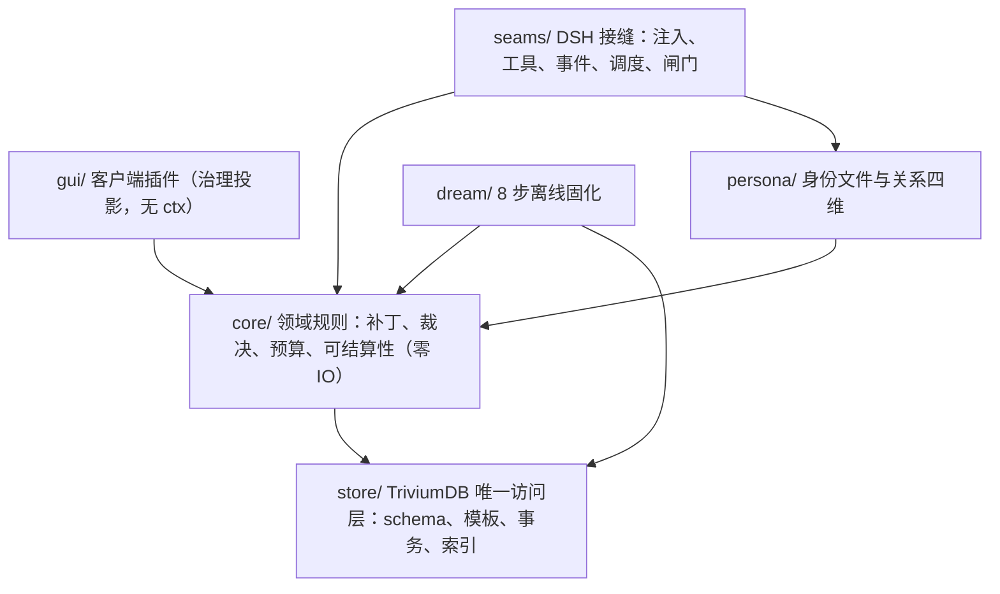
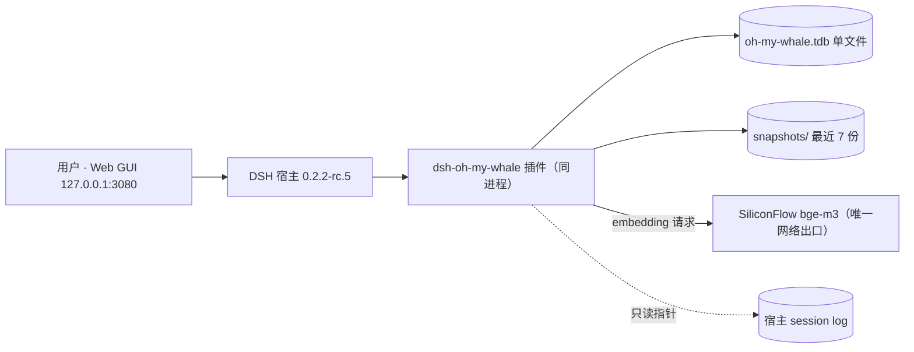
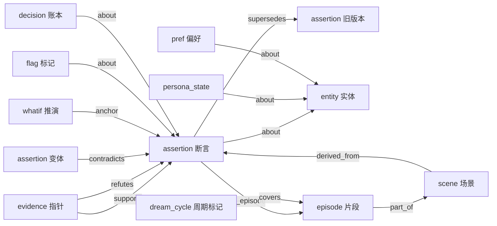

# Architecture Spine — DSH 哦鲸鲸

## Design Paradigm

分层 + CQRS-lite：写入只有一条路（补丁表 → 单次事务），读取只有一条路（查询模板 → 只读投影）。两层各自单向，使「谁能写库」和「谁能拼 TQL」这两个最容易腐化的权力，各只有一个持有者。



反方向一律禁止：`store/` 不 import 任何其他层，`core/` 不 import `seams/`（否则领域规则被宿主细节污染），`gui/` 不得 import `store/`。依赖方向由 eslint 规则执行（AD-15），不是口头约定。

## Invariants & Rules

### AD-1 — 单进程纯插件，不新增部署单元 [ADOPTED]

- **Binds:** all
- **Prevents:** 出现第二个常驻进程、IPC 协议、端口监听、文件锁；以及把后台工作交给自建守护进程这类分叉。
- **Rule:** 全部逻辑在 `apply(ctx, config)` 内注册，随 fiber 销毁由 ctx 回收；后台代码任务只用 `ctx.timer`（进程内、随 fiber 销毁，插件需 inject timer）；`ctx.schedule` 是宿主的提醒投递——它把 prompt 当 user 消息送进目标 Session、还会触发模型轮次，所以只服务 Deferred 里的主动搭话，且必须经 `seams/schedule.ts` 单一出口；禁止 spawn 子进程、监听端口、跨进程锁文件（`worker_threads` 是同进程线程，不在此列——AD-8 的召回就靠它）；显式资源一律走 `ctx.effect()`。**本插件不提供任何进程外可执行入口**（2026-11-25 用户裁定「不要任何 CLI，只保留 command」）：`package.json` 不写 `bin`，`scripts/` 只放开发期工具（构建、lint、层依赖检查、gate、评测驱动），不承载面向用户的命令；所有面向用户的命令都是聊天内斜杠命令，经 `ctx.commands.register` 注册。

### AD-2 — 单文件库直连，不设存储适配层 [ADOPTED]

- **Binds:** CAP-1, CAP-5, store/
- **Prevents:** 一层「以后可能换库」的抽象把 TriviumDB 的语义削平（图扩散、`payloadFilter`、快照校验、字段 CAS 全部退化成通用 CRUD）。
- **Rule:** 业务代码只经 `store/` 导出的具名函数访问库；`store/` 内部直接调用 `TriviumDB` 方法，不引入通用 repository/port 接口。只有在出现第二个存储后端时，才允许抽象。

### AD-3 — 身份落在索引键，不落在节点 id [ADOPTED]

- **Binds:** CAP-1, CAP-3, store/
- **Prevents:** 用 `uuid5 → number` 伪造稳定性（128 位压进 53 位必撞）；重建或迁移库后一切外引失效；两处各自维护 id 映射。
- **Rule:** 节点 id 视为存储局部量，禁止写进导出文件、配置、运行日志或 flag 负载；业务身份 = `mem_key` 字符串 `<kind>:<subj>:<pred>[:<obj_norm>]`（其它 kind 用 `<kind>:<稳定名>`：`pred:<谓词规范名>`、`entity:<规范名>`、`pref:<key>`、`dream_cycle:<date>`）；唯一索引建在 **`(mem_key, active_slot)`**：活动版本写 `active_slot = 1`，被 supersede 时写 `active_slot = superseded_at 的毫秒数`，于是「同一 `mem_key` 至多一条未失效」由数据库在 `insert` 与 `updatePayload` 上强制（实测抛 `TDB_UNIQUE_CONSTRAINT`），既不依赖部分唯一索引，也不依赖 `compareAndSetPayloadField`；`obj_norm` 的算法带 `norm_version` 并写进 payload，换算法必须走一次 `ops/rekey` 迁移（先快照、每条改动写 `decision`），禁止静默升级；跨版本引用只许用 `mem_key`；`(mem_key, valid_from)` 另建普通复合索引供历史查询。补丁表由 core 依本轮读到的活动版本算出**完整最终 payload**，`store/commits` 单写者串行提交；冲突以唯一索引抛错为准，抛错即写 `rejected`，不靠 CAS。

### AD-4 — 唯一写入口，一次业务写入一次事务 [ADOPTED]

- **Binds:** CAP-1, store/
- **Prevents:** 写入散落各处、半写入、同一轮对话两次覆盖、审计链断裂。
- **Rule:** `insert` / `insertWithId` / `batchInsert` / `upsertWithId` / `patchPayload` / `updatePayload` / `updateVector` / `link` / `upsertEdge` 只允许出现在 `src/store/`（`compareAndSetPayloadField` 只允许出现在 `src/ops/` 的修复路径）；写事务入口 `commitTransaction` / `tqlMut` 的辖区见 AD-15（仅 `src/store/commits`）——**两条门不得重叠判同一行**；一次业务写入 = 一张补丁表 = 一次 `commitTransaction`，可含多种 op；被拒补丁不得静默丢弃，须在同一事务内写一条 `rejected` 记录（含原因与原始补丁）。写入口只有三个，且共用这一段：`remember` 工具、用户显式命令、`agent/turn-stopping` 后的去抖抽取（默认 3s 去抖，可关）；抽取只读本轮新增的 seq 区间，不回溯、不外扩。监听器只做三件事——从 agent 解析 session、把 `turn` 记进内存待抽取集合、**同步返回**；去抖与 max-wait 一律走 `ctx.timer`（每会话一个、max-wait 默认 10s），因为该事件是 `@mode serial` 且被 await 之后才允许边界提交，睡在监听器里等于每个 turn 多等 3–10 秒；`agent/turn-stopping` 的 payload 只有 `{agent, turn, signal}`、不含 session 与 seq，所以会话由 seams 层从 agent 解析、seq 区间由持久游标 `extraction_cursor:<session_id>` 推进，同一 turn 重复触发按 `turn` 号去重——否则全局去抖会把两个会话并成一个单会话证据指针。再加一条进程内约束：全进程只有一个写队列 `store/commits/queue.ts`，所有 `commitTransaction` 经它串行提交，优先级 对话写入 > 快照 > dream（dream 在提交边界让出）；任何模块不得自行加锁，也不得绕过队列直接 await 提交。

### AD-5 — 三轴时间 + supersede，无物理删除 [ADOPTED]

- **Binds:** CAP-1, CAP-3
- **Prevents:** 静默硬删；覆盖写导致历史不可回溯；查询忘记过滤旧版本而召回已失效记忆。
- **Rule:** 每条断言同时具备世界时间 `valid_from` / `valid_to`（半开区间）、记录时间 `recorded_at`、失效时间 `superseded_at`；**未失效时不写该字段、不写 null**，一切查询用 `superseded_at: {$exists: false}` 表达「未失效」，历史查询显式传 `validAt(t)` / `knownAsOf(t)`；`delete(` / `deleteManyAtomic(` / `unlink(` / `unlinkLabel(` 与事务 op 字面量 `type: 'delete' | 'unlink' | 'unlinkLabel'` **全仓禁止**（实例上根本没有 `unlinkLabel` 方法，它只有事务 op 形态）；只留三个具名豁免，文件头必须写 `// AD-15 豁免：<用途>`——`ops/snapshots.ts`（快照目录）、`ops/retention.ts`（审计与日志轮转）、`ops/dispose.ts`（卸载时先导出再删除）；撤销 = 在同一事务里把 `superseded_at` 与 `active_slot` 还原、并整体重写受影响 payload（事务 op 只有整体替换的 `updatePayload`，能 `$unset` 的 `patchPayload` 不是事务 op），逐条可回滚——全库快照恢复是灾难恢复，不是撤销机制。

### AD-6 — 证据是指针，不是副本 [ADOPTED]

- **Binds:** CAP-1
- **Prevents:** 记忆库变成第二份对话日志，体积、脱敏与宿主逐步不一致。
- **Rule:** evidence 负载只允许 `{session_id, seq_from, seq_to, quote ≤200 字符, quote_truncated, deidentified}`；禁止写入完整消息体；读原文一律回宿主只读日志（`ctx.sessionQuery` 的 `listEvents` / `readEvent`）；指针存在性检查只在 dream 第 ① 步执行，召回路径只做 seq 语法校验、不回读原文，结果写 `flag(flag_type=dangling_evidence, status=open)`。`deidentified` 由写入路径计算：命中手机号 / 身份证 / 邮箱 / 银行卡正则即置 `true`，`quote` 换成脱敏版（保留 `quote_truncated` 与原长度）；`ops/export.ts` 与快照默认排除 `deidentified=true` 的引文，需要用 `--include-sensitive` 显式导出。`sessionQuery` 是可选能力：provider 缺席或查询失败时，指针降级为不可解引用——召回仍返回该指针但标 `degraded: 'evidence-unresolvable'`，绝不伪造原文（属 AD-18 的局部降级，不进 AD-13 的全停）。

### AD-7 — 注入只有一个出口，且带预算表 [ADOPTED]

- **Binds:** CAP-1, CAP-4, seams/
- **Prevents:** 各模块自行调 `section()` 导致前缀缓存天天失效；预算失控；说不清一轮对话到底注入了多少。
- **Rule:** 两条注入通道各管一档，不得混用：身份段（≤1200 字符、字节稳定）走 `ctx.systemPrompt.section({name:'harness:identity', order, text})`——它的渲染结果被提交为节点 0，文本一变就原地替换、击穿前缀缓存，所以不许承载任何逐轮变化的文本；状态尾巴（≤30 token、每轮可变）**只能**走 `ctx.systemPrompt.context({name:'omw:persona-state', order, text})`，那是宿主给出的 cache-safe 通道，快照只在变化或 compaction 后才追加；两处都只允许出现在 `seams/prompt-composer.ts`；它持有预算表——身份段 ≤1200 字符、状态尾巴 ≤30 token（关系四维与档位 ≈12、最近一条已确认偏好 ≈10、一条待处理 flag ≈8）、场景常驻为 0；身份段文本哈希不变即不重写，保持字节稳定；超预算按 身份 > 状态 > 召回 顺序裁剪并记账。此处有意取代设计稿的 ≤120 token 常驻档：v1 只留身份段与 30 token 尾巴，场景与更多偏好走按需召回（用户第四轮裁定）。

档位与预算一览：

| 档位 | 内容 | 上限 | 变化频率 |
| --- | --- | --- | --- |
| 身份段 | `persona.md` 四段 | 1200 字符 | 几乎不变，字节稳定 |
| 状态尾巴 | 关系四维与档位、一条已确认偏好、一条待处理 flag | 30 token | 每轮可能变 |
| 按需召回 | 候选 → 重排 → 剪枝，最多 5 条 | 三段合计 ≤1000ms | 提问时，重排每轮至多一次 |

### AD-8 — 召回只读、有界、模板化 [ADOPTED]

- **Binds:** CAP-1, CAP-2, store/
- **Prevents:** 召回写回（改热度、稳定性、计数）；TQL 拼接注入；无界翻页吃光上下文。
- **Rule:** 查询只能经 `store/templates/` 导出的具名函数发起，其内部用 `prepareTql` + `executePreparedTql` 参数化、并按模板常量缓存预编译对象；模板之外不得出现 TQL 字面量；`topK` 默认 5、硬上限 8。召回按**三段预算**切分，每段各有退路，任何一段失败都不得把另一段拖成空：
  - ① **候选**（本地，`worker_threads`，≤`recall.timeoutMs` 250ms）：`search()` 是同步原生调用、没有 timeout 参数，所以放线程里跑（AD-1 禁的是子进程与端口，不是线程）；worker 侧用 `RequestContext(id, timeoutMs)` 让原生自己查期限（超限抛 `TDB_QUERY_DEADLINE_EXCEEDED`）。
  - ② **重排**（System One，模型调用，≤`rerank.timeoutMs` 600ms，**默认开启**）：经 SiliconFlow 的 `POST /systemone` 打**打分型（score）**问题，模型取 `rerank.model`（默认 `SemIf`，备选 `Kev-4b`，选型见 Stack），候选按 `answers` 的键一一回填、不缺失不新增；该端点属 Alpha（可能调整或停用），停用时整段按下面「超时/报错」处理。② **只产分数**：去重与剪枝是确定性规则（阈值 + top-k），不交给模型决定删谁——模型说「这条不重要」只能变成低分，不能变成删除。超时、报错或熔断都只是**跳过②、按①的顺序照常注入**并标 `degraded: 'rerank_unavailable'`——重排是增强不是通行证。同一 `(session_id, turn)` 至多触发一次，结果按 `(query_hash, 候选指纹)` 缓存 10 分钟，避免一轮内多次工具调用重复付 600ms。
  - ③ **注入**（≤20ms）：按重要度取前 5 条并压到注入预算；取不满就少给，不凑数。

硬上限 1000ms：到点交①的结果，**不返回空**。连续 3 次重排超时熔断 10 分钟（期间只走①③），与 AD-19 的 embedding 熔断分开计数。日调用上限 `budget.rerankCallsPerDay`（见 AD-26），命中即降级为①③并写一行审计。只有①本身失败才算「没有细节」的真降级；②③缺席都是可解释的降配。检索必须带 `payloadFilter: {superseded_at: {$exists: false}}`，这个过滤器只在 `store/filters.ts` 的 `liveOnly()` 一处构造（`$exists` 未进 0.9.3 的类型声明，本地放宽 `FilterOperator` 并钉死版本，M0 补一条语义测试）；集合类条件（`$in` 一类）不进 TQL 参数——`executePreparedTql` 只收标量——由模板构造成 `payloadFilter` 对象；排序纪律：先由①的硬阈值（有效性、scope、来源存在）过滤，再由②按 相关性 × 重要度 重排，时间衰减与访问热度只作读时排序因子、绝不写回；②缺席时保留①的顺序并在审计行标 `rerank_unavailable`；召回路径禁止任何写调用（含 `updatePayload` 与 `flush`）。`enableRefractoryFatigue` 默认关闭；开启时它是引擎内部状态、不落 payload，因此不违反「召回不写」，且只读实例不得开启。

### AD-9 — 三级裁决，自动档只做符号可判 [ADOPTED]

- **Binds:** CAP-3
- **Prevents:** 让模型自己判冲突而造成误删；矛盾永远悬空、两边都留着。
- **Rule:** 自动裁决成立当且仅当 谓词基数为 `single`（基数读自 `pred` 节点，且只有 `decided_by ∈ {user, seed}` 的声明算数；模型新建的谓词默认 `multi`，见 AD-27） ∧ 同 `(kind, subj, pred)` ∧ 有效区间重叠 ∧ `obj_norm` 不同（`multi` 谓词的不同 obj 本就可共存，不算冲突）；处理方式为 旧断言置 `superseded_at` + 插入新断言 + 一个 `flag` 节点（`flag_type=contradiction`、`status=resolved`、`resolved_by=auto`）+ 一条 `contradicts` 边，全部在同一次 `commitTransaction` 内；其余冲突只允许「提案 + 挂起」，不得改动既有断言；人工档是解除挂起态的唯一路径。注意 `flag` 是节点不是边：治理视图靠 `kind=flag ∧ status=open` 查询。此处**显式覆盖**简报「落库一律待人确认」的主张：覆盖的理由是可回滚（见 AD-22），不是「自动更省事」。

### AD-10 — 固化确定性先行、幂等、有预算 [ADOPTED]

- **Binds:** CAP-2, dream/
- **Prevents:** 梦境跑一半重复写入；模型步骤乱序改数据；一次异常的重放抽样烧掉整晚。
- **Rule:** 8 步顺序固定，权威清单：①确定性结算 ②重放抽样 ③模式提取(LLM) ④场景抽象(LLM) ⑤What-If(LLM，v1 生成默认关闭) ⑥剪枝归档 ⑦跨主题重组 ⑧策略提炼(LLM)；①②⑥⑦ 不得调用 LLM（⑦ 跨主题重组以校验与合并为主，不生成新内容）；③④⑤⑧ 的模型步骤一律**先提炼后核验**：提炼用 `dream.extractModel`（默认 `Qwen/Qwen3.5-9B`，原定 4B 在 G0-8 实测不可用），核验用 `dream.verifyModel`（默认 `deepseek-ai/DeepSeek-R1-0528-Qwen3-8B`）检查「证据指针是否齐全、结论是否与证据或前序步骤矛盾」；调用方在问核验之前先挡两种「不可能是产物」的情况——产物零断言、或断言缺证据指针——直接不提交并记 `dream_log(verify_failed)`，不靠模型自觉（G0-8 实测：空产物 R1 会判 pass）；核验不通过则该步不提交、停在段边界并记 `dream_log(verify_failed)`，已花预算不回收，⑥ 之后的步骤按缺步处理而不是带病继续；确定性步骤的函数签名只收 `{store, clock, config}`，不得注入 `llm`，`test/dream/no-llm.test.ts` 断言其依赖对象不含 `llm` 键。每步产出 diff 后**独立提交一个 `dream_log` 节点**（阶段、种子、diff、tokens），崩溃可从最后完成的阶段续跑，而不是重跑整夜。② 的随机源由 `seed = hash(date, stage)` 决定并写进 `dream_log`，同日重跑结果可复现；周期标记 `dream_cycle:<date>` 取**本地时区**日期并把 `tz` 与 `utc_offset` 写进节点，夜间窗口为本地 02:00–05:00，由唯一索引保证一天一次；预算三层叠加、取最小：阶段预算 ≤ 日 token 上限 ≤ provider 配额，命中即停在段边界并记 `dream_truncated`；`--dry-run` 只跑 ①② 并出 diff、不写库；错过**不补历史多天、只补当天一次**：启动时若 `dream_cycle:<date>` 不存在且不在安静时段，排一次补跑并标 `late`——桌面宿主夜间不常开，纯定时等于永不运行；「从未跑过」必须能在审计里看见（最近一次固化的日期与结果）。**空闲触发**（2026-11-23 用户裁定追加，PRD FR-10 已同步）：长会话跨过安静时段时，最后一次交互后 30 分钟无新事件即开始一次 cycle 并标 `idle_triggered`；三条护栏——(a) 仅在无进行中轮次且无排队写入时触发；(b) 当天 `dream_cycle:<date>` 已存在则直接跳过，故一天最多一次；(c) 触发途中用户发起交互，只在**段边界**让路（当前步提交完再停，可从断点续跑），绝不打断写事务（NFR-3 的 p95 ≤10ms 不被侵犯），也不占下一轮首 token 路径。⑤ 的开跑约束先写死，免得将来放开时无规则：深度 ≤2、默认 K=1、一锚点一分叉、先剪候选、产物永不进断言层。两条 G0-8 实测约束一并写死：**提炼调用必须关思考**（Qwen3.5 是 thinking 模型，不关时单次 86s、`max_tokens` 拦不住思考 token、常超时；关掉后 11–13s，核验调用保持默认思考）；**证据指针的机械核验在本地做**（引文是否原文子串、`seq` 是否存在、`session_id` 是否对得上），模型只做语义层核验——实测核验模型会把与原文完全相同的引文误报 `quote_not_found`，把机械判断交给模型等于给自己造假失败。

### AD-11 — 身份不依赖库，状态允许缺席 [ADOPTED]

- **Binds:** CAP-4, persona/
- **Prevents:** 库坏了人格就没了；缺值用默认值假装有状态（编造关系）。
- **Rule:** `assets/persona.md` 随插件发布、字节稳定，直接从文件读，不落库；`persona_state` 只走 `ctx.systemPrompt.context()`（禁走 `section()`），上限 30 token；库不可用或字段缺失时整段省略，禁止填默认值；身份段与状态段各自独立 try/catch，一方失败不影响另一方。

### AD-12 — 关系数值化，边界在工具层拦截 [ADOPTED]

- **Binds:** CAP-4
- **Prevents:** 靠 prompt 措辞维持分寸；关系随对话漂移无锚点；越界全靠模型自觉。
- **Rule:** 四维 `temperature` / `trust` / `intimacy` / `understanding` 初值 50，权重 1.0/0.7/0.8/0.6，单次事件步长 `±3×intensity`（负向 `−2×intensity`），三档阈值 `<45 / 45–69 / ≥70`，`closeness=(intimacy+trust)/2`；越界检查在工具 `execute` 之前执行并直接返回拒绝，不得用 prompt 提示替代。

### AD-13 — 底座故障整体 no-op [ADOPTED]

- **Binds:** CAP-5, seams/
- **Prevents:** 半活插件产生幽灵行为——注入旧状态却不写、工具有一半可用、用户以为记忆在生效。
- **Rule:** 打开库失败、`verifySnapshot` 不符、配置 `db.dim` 与库 meta 不符、`contract_version` 不符 → 不注册 section、不注册可执行工具（若需占名则 `execute` 恒返回拒绝）、不排 dream、不写任何节点，只向宿主日志写一行原因；恢复需重载插件，不在进程内自愈重试。资源超限（`ResourceBudgetError`）按同一档处理，不进业务重试；库以 `memoryLimitMb` 与实例资源上限设界。唯一例外：缺 embedding 凭据**不进全停**，只永久关闭向量路径，文本与图召回照常（属 AD-18 的局部降级）。**降级只有两档**：要么整体 no-op（本条），要么只关向量路径（AD-19 的 401/402、AD-23 的维度不符）；不存在「半开」——不写一半、不注入半段。 **2026-11-25 修订——「两档」只管记忆面**：本条规定的档位只覆盖**记忆安装位**（profile 位，提供四工具与库）。同一进程内的另外三个安装位各有自己的档位、互不牵连：**人格安装位**（`omw-main` preset 里的 `dsh-oh-my-whale/main`）**不打开库**，因此没有降级档位——库坏时身份段照常注入且字节不变（AD-11），尾巴整段省略；**路由安装位**（`entry-routing.md`）只依赖 `routing.json`，库坏时派发照常、账本坏即 `E_GATE_DOWN` 停路由；**上下文治理安装位**按 `CONTEXT-GOVERNANCE.md` AD-36 的五档。理由：`CONTEXT-GOVERNANCE.md` AD-36 已立「降级与记忆、人格互不牵连」，本条与它是同一条原则的两个侧面。所以原句读作「记忆面只有两档」，**不是**「全插件只有两档」；「不存在半开」的禁令仍只对记忆面生效。两处 `dim` 判定分工：建库 `dim` 与库 meta 不符属打开时故障（本条全停），embedding 返回维度 ≠ `db.dim` 属运行时故障（AD-23 只关向量路径）。 **2026-11-25 修订——错误码封闭集由 8 扩到 11**：新增 `OMW_ROUTE_LOAD`（账本读不出）/ `OMW_ROUTE_DISPATCH`（派发事务失败）/ `OMW_ROUTE_MISMATCH`（会话 id 与账本不一致），来自 `entry-routing.md` §七。它们与既有八个**平级并列、仍封闭**，只有基数变大；新增或改名仍算破坏兼容。同批修订点见该文件 §七 的显式修订条。

### AD-14 — 快照纪律：每日 + 迁移前 + 留 7 份 [ADOPTED]

- **Binds:** CAP-5, ops/
- **Prevents:** 事故只能靠软删除兜底；迁移一半失败无法回退；快照本身损坏却以为有备份。
- **Rule:** 触发方式不是「夜间 04:00 定时器」——桌面宿主夜间不常开，那样会一份快照都没有；而是**每次插件启动检查「今天有没有已校验的快照」，缺则补做**。快照**可重入但不幂等**：`createSnapshot` 撞到同名目录直接抛 `TDB_SNAPSHOT_EXISTS`（已实测），所以目录名带尝试序号 `snapshots/<日期>-a|b|c`；启动流程是「先 verify 今天最新一份 → 过就跳过 → 不过或没有就用下一个未占用后缀新建」，`TDB_SNAPSHOT_EXISTS` 是预期分支、不是错误。它不受 AD-10 的 dream 补跑规则约束（那条只针对 dream）：重复运行最多多一份已校验快照，由保留策略收敛到 7 份。每日一次 `createSnapshot(dir, generationId)` 后立刻 `verifySnapshot` 校验 manifest（crc32/sha256、`complete=true`，manifest 未带 sha256 的分支降级为只校 crc32）；迁移前强制一次快照；保留最近 7 份，超出按目录删除（快照目录清理是全仓唯一允许的物理删除，AD-15 对它单独豁免）；迁移只用 `migrate`，恢复只用 `restoreSnapshot` 且**必须先 `close()` 停库再恢复**（单文件库在 Windows 上有句柄锁），迁移先 `--dry-run`。

### AD-15 — 静态门：依赖方向与写权 [ADOPTED]

- **Binds:** all
- **Prevents:** 时间门被绕过（TQL 跑出模板层）、写入口被复制、物理删除混进业务代码。
- **Rule:** eslint 强制分层依赖（`store/` 不 import 其他层、`core/` 不 import `seams/`）；CI grep 失败即阻断：`ctx.systemPrompt.section(` 与 `.context(` 只允许出现在 `src/seams/prompt-composer.ts`；`child_process`、`net.createServer`、锁库（`proper-lockfile` / `flock`）全仓禁止；`triviumdb` 只允许被 `src/store/**` import（eslint `no-restricted-imports` 反写白名单，其他层连它的类型都不许 import）；`prepareTql(` / `executePreparedTql(` 只允许出现在 `src/store/templates/`；写方法全清单 `insert|insertWithId|batchInsert|upsertWithId|patchPayload|updatePayload|updateVector|link|upsertEdge|compareAndSetPayloadField|indexText|indexKeyword|dropIndex|flush|commitTransaction|tqlMut` 只允许出现在 `src/store/commits`（`compareAndSetPayloadField` 另准 `src/ops/` 的修复路径）；只读裸 `tql(` 只允许出现在 `src/ops/`；**硬删清单** `delete(` / `deleteManyAtomic(` / `unlink(` / `unlinkLabel(` 与事务 op 字面量 `type: 'delete' | 'unlink' | 'unlinkLabel'` 全仓禁止——注意实例上没有 `unlinkLabel` 方法，所以 grep 必须同时覆盖方法形态与 op 字面量形态；TQL 参数化用 AST 规则表达（eslint `no-restricted-syntax`）：`prepareTql` / `executePreparedTql` 的第一实参必须是字面量或无插值模板（`expressions.length === 0`）；方法级禁令同样落 AST——接收者必须是库句柄标识符——否则裸文本 grep 会误伤 `Map.delete` 这类同名调用。

**NFR-13 具名豁免（2026-11-25 登记于本 AD）**：`child_process` 的「全仓禁止」有一个具名例外——`src/eval/` 与 `scripts/` 目录内允许**一次性短命**子进程（`spawnSync` 语义，无常驻、无监听、无后台），用于评测驱动与 fixture 生成；`src/` 其余位置仍由静态门禁止。判据是「无常驻、无监听、无后台」三条，不是「有无子进程」。v1 交付物里不出现任何子进程调用（唯一会用它的 FR-61 已 Deferred），故本豁免当前无生效调用点，属边界铺垫。

### AD-16 — mnemon 替换而非共存，幂等且可回滚 [ADOPTED]

- **Binds:** CAP-5, CAP-6（迁移）
- **Prevents:** 两套记忆并存各回答一次；重复迁移产生重复节点；迁移失败无法退回旧行为。
- **Rule:** 一次性把 `USER.md` 按 `§` 分段、`MEMORY.md` 逐条转为 `pref` / `assertion` 节点，`mem_key` 用业务身份（`pref:<规范化 key>` 或 `assertion:<subj>:<pred>`），**不用 uuid5 当身份**；`uuid5(namespace, file:linehash)` 只写进 payload 的 `migration_id`，用来判定「这一行已经迁过」，保证重复运行不产生重复节点；不删除、不修改 mnemon 源文件；`config.legacyMnemonInject = true` 并**重启插件**后恢复旧注入（配置不热读，AD-13 的「恢复需重载」同样适用），迁移节点保留待人工清理。

### AD-17 — 推断必须可结算 [ADOPTED]

- **Binds:** CAP-2, CAP-3
- **Prevents:** 模型推断与观测事实混为一谈；永远无法判对错的「洞察」越积越多；事后无法追责。
- **Rule:** `origin=inference` 的断言必须携带 `falsifier` 与 `settle_state ∈ {open, confirmed, refuted}`；`falsifier` 是判别联合 `{op ∈ {eq, ne, gt, lt, gte, lte, exists, count_gte}, field ∈ <白名单>, value}`，白名单与 TBox 同处 `store/tbox.ts`（`valid_to`、`superseded_at`、`evidence.count`、`flag.status` 等），不开放的字段就是不可结算的推断；缺 `falsifier` 或不合法（zod 拒收）的推断禁止以 assertion 入库，只能降级为 scene 描述文本；结算只在 dream 的确定性步骤发生；`refuted` 不得删除，改为 `superseded` + `flag(refuted)`。

### AD-18 — 注入与工具解耦降级 [ADOPTED]

- **Binds:** CAP-1, seams/
- **Prevents:** 工具注册失败连带注入失败（或反之），一处局部异常拖垮整条链路。
- **Rule:** 注入与工具注册各自独立 try/catch、独立降级；工具缺席时注入仍完整工作，注入失败时工具仍可用；两者共用同一库句柄，但不得互相回滚。与 AD-13 分工：AD-13 管「库不可用 → 全停」，本条管「库可用但模块局部异常 → 局部退化」。

### AD-19 — 向量异步补写，不阻塞写入 [ADOPTED]

- **Binds:** CAP-1, store/
- **Prevents:** embedding 变慢或不可用时拖住 DSH 的每一轮对话；因写入等向量而丢记忆。
- **Rule:** 写入不等 embedding：节点先以 `vec_state: pending` 落库，随后异步 `updateVector` 并置 `ready`；补写失败有限次重试后记 `vec_state: failed`；`pending` / `failed` 节点只参与文本与图路径召回，不参与向量路径；连续 3 次补写失败即熔断 10 分钟，期间全走文本与图，恢复后批量补写；401/402（凭据无效、欠费）不重试、直接关掉向量路径并报 `OMW_EMBED_AUTH` / `OMW_EMBED_QUOTA`，只有超时与 5xx 才走重试；embedding 单次超时上限 2s，严禁在写事务内同步等待。补写只由 `store/embedding.ts` 的启动扫描发起（≤50 条/次、≤3 次/分钟、按 `recorded_at` 升序），dream 不参与补写；`failed` 只在人工 `reembed` 命令下重试。

### AD-20 — 每次注入与召回都可核 [ADOPTED]

- **Binds:** CAP-1, CAP-5
- **Prevents:** 预算停留在纸面；「有没有拖慢 DSH」只能靠感觉；事后无法解释某条记忆为何被注入。
- **Rule:** 每次注入写一行 `audit.jsonl`：`{ts, session_id, tier, chars, tokens, items[], truncated, prefix_unchanged, host_cache_read, host_cache_write, host_cache_uncached}`——后三个取自宿主的 token 计量投影（`cacheReadTokens` / `cacheWriteTokens` / `uncachedInputTokens`），命中率按会话聚合为 `ΣcacheRead / (ΣcacheRead + ΣcacheWrite + Σuncached)`，`prefix_unchanged` 只作辅助字段；每次召回写一行：`{ts, session_id, query_hash, top_k, hits[], elapsed_ms, degraded, degraded_reason[]}`——`session_id` 是那次召回所属的会话，无会话时写空串而不编造一个，`degraded_reason` 取值封闭为 `recall_timeout | rerank_unavailable | rerank_circuit_open | vec_unavailable | embed_circuit_open | budget_truncated`（可多值，空数组即未降级）；dream 每次运行写一行汇总。审计行只落文件不落库，按天切分 `audit-YYYYMMDD.jsonl`、保留 30 天，轮转与删除只经 `ops/retention.ts`。注入路径的同步预算：`compose()` 单次 p95 ≤20ms，审计写入异步（`appendFile` 队列），注入路径上不做任何库查询；超预算降级为只注入身份段并记 `E_BUDGET`。注入路径不查库：身份段直接读 `assets/persona.md`（AD-11），状态尾巴取本回合已算好的值，缺值整段省略——不临时查询、不填默认值。

### AD-21 — 决策账本：每条改动都留下谁、依据什么、为什么 [ADOPTED]

- **Binds:** CAP-3
- **Prevents:** 治理只能答「现在是什么」，答不出「谁改的、依据什么、为什么」；同一个坑反复踩且判例无法复用。
- **Rule:** 每次改动（写入、自动裁决、人工裁定、迁移）在**同一事务**内写一个 `decision` 节点：`{ts, actor(model|user|dream|migration), kind(insert|supersede|arbitrate|resolve_flag|migrate|revert), op_id, affected[], target_mem_key, from?, to?, reason, precedent_id?, contract_version}`；人工裁定可指定 `precedent_id` 复用可撤销先例，先例只影响建议排序、不自动改数据；`decision` 只增、不改、不删。断言自身也必须带来源：`actor`、`cause(conversation|tool|dream|migration)`、`prompt_version`，dream 产物另带 `cycle_id`——否则「这条是哪版提示词生成的」永远答不出来。

### AD-22 — 撤销是一个操作单元，不是一条字段 [ADOPTED]

- **Binds:** CAP-3, store/
- **Prevents:** 「删错了」只能靠整库快照回滚；级联改动（flag、contradicts 边、scene 废弃、召回结果）撤一半，留下自相矛盾的状态。
- **Rule:** 每个 `decision` 携带 `op_id` 与 `affected[]`；`affected[]` 的闭包 = 该操作写入或改动的全部**状态**节点与边——断言、flag、scene、evidence，以及 `supersedes` / `contradicts` / `part_of` 这些边（边以 `(from_key, label, to_key)` 表达，绝不用节点 id）；只增账本（`decision`、`dream_log`、`rejected`、`dream_cycle`）不在闭包内，也永不撤销。撤销 = 按 `op_id` 反向生成补丁表、在**一个事务**里执行，并追加一条 `decision(kind=revert, precedent_id=原 op_id)`；复合操作要么整体撤销、要么整体不动；判据是「撤销后默认查询与召回结果逐条等于操作前」，**比较时排除账本类节点**——否则追加 revert 记录本身就会让这条判据自我否决。

### AD-23 — 外部 provider 只有一个出口 [ADOPTED]

- **Binds:** CAP-1, store/
- **Prevents:** 向量化散落各处、换 provider 要改十几处、密钥漏进日志或 payload、成本无人负责。
- **Rule:** 外部调用只有三条通道，一个通道一个文件、各自独立熔断与独立预算：`src/store/embedding.ts`（`POST /embeddings`）、`src/seams/llm.ts`（chat completions，抽取与固化提炼/核验）、`src/seams/systemone.ts`（`POST /systemone`，② 重排打分）。除这三个文件外不得发起网络请求。embedding 签名固定 `embed(texts: string[]): Promise<number[][]>`；endpoint 与 model 来自配置，密钥只从 `embedding.apiKeyEnv` 指向的环境变量读，禁止写进配置、日志或 payload；返回维度必须等于 `db.dim`，不等即 `OMW_DIM_MISMATCH` 并关掉向量路径；单批 ≤16 条、单条 ≤8192 token；调用次数与 token 记进审计行，日上限与 dream 预算共用；换 provider 只换这一个文件，其余代码不得感知。

### AD-24 — 治理投影是唯一的只读出口 [ADOPTED]

- **Binds:** CAP-3, gui/
- **Prevents:** `gui/` 拿不到 ctx 却各自发明查询；两个单元一个在 `core/` 加 `getFlagQueue()`、一个在 `seams/` 加 IPC 通道，最后两套数据口径。
- **Rule:** 只读数据只能由 `core/projections/*.ts` 的纯函数产出 DTO——`flagQueue`、`versionChain`、`exportJsonl`、`explain`——DTO 自带 `contractVersion`；经 `seams/projection-bridge.ts` 暴露给浏览器侧插件。`gui/` 只允许 import 这些 DTO 的类型，禁止自行推导查询、禁止 import `store/`。客户端插件拿不到 ctx，所以 bridge 是唯一通道：这条不通，治理界面就只能等。

### AD-25 — 工具面是本插件的公开契约 [ADOPTED]

- **Binds:** CAP-1, CAP-4, seams/
- **Prevents:** 模型侧契约被两个单元各写一遍；工具改名要动提示词却没人当它是破坏性变更。
- **Rule:** 工具名与入参固定：`recall(query, topK?≤8)`、`remember(patch)`、`forget(mem_key, reason)`、`explain(mem_key)`；返回统一包封 `ok / items? / degraded / reason?`；错误码封闭为 `{E_BUDGET, E_TIMEOUT, E_DEGRADED, E_BOUNDARY, E_GATE_DOWN}`。工具描述与入参是提示词的一部分，改名即破坏兼容；新增或改签名必须先改本条 AD。越界检查在 `execute` 之前执行（AD-12），不靠提示词。

### AD-26 — 配置与预算只有一个出处 [ADOPTED]

- **Binds:** all, seams/
- **Prevents:** 键散落各处、各加各的；互斥开关没有地方承载；外部调用成本无人封顶。
- **Rule:** `src/seams/config.ts` 导出唯一的 zod schema，列出全部键、默认值与互斥规则（例：`enableRefractoryFatigue=true` 且 `accessMode=readOnly` 直接启动失败）；环境变量只承载 `SILICONFLOW_API_KEY`，其余一律走配置。预算四键 `extractionCallsPerDay`、`embeddingCallsPerDay`、`rerankCallsPerDay`、`dreamTokensPerDay`：命中后抽取降级为「只记不抽」、embedding 停止补写、②重排降级为①③（召回仍返回候选）、dream 停在段边界，并各写一行审计。`rerank.enabled=false` 时 `rerank.*` 与 `rerankCallsPerDay` 一律忽略（不改默认值，只短路）。

**v1 增补的三个键（2026-11-23）**：`recall.candidatePool` 默认 12——① 段的候选池上限，`recall.topK` 仍是 5、硬上限 8，候选池是最外层的闸门；`persona.strengthMax` 默认 5——四维事件强度上限，步长据此封顶 +15 / −10；`tbox.maxNewPredsPerDay` 默认 20——每天允许新建的谓词数（AD-27）。三者必须进 schema 与默认值测试，代码里不得另存一份默认值。

新增键必须改本条 AD 并补 schema 测试。

### AD-27 — 谓词是数据，不是白名单 [ADOPTED]

- **Binds:** CAP-1, CAP-2, CAP-3, store/
- **Prevents:** 封闭白名单让「没见过的说法」只能落成场景文本；开放谓词又让模型自造 `single`，从而误触发自动裁决。
- **Rule:** 谓词登记表由 `pred` 节点承载（`mem_key = pred:<规范名>`，payload `{pred, cardinality, status, aliases[], decided_by, decided_at, evidence_count, norm_version}`）；10 个种子谓词随安装写入，但表是**开放集合**——每次落盘先读一份表快照（进程内缓存、提交后失效），模型判断现有谓词是否够用，不够就在同一事务内新建一条（`cardinality=multi`、`status=candidate`、`decided_by=model`）并挂 `flag_type=predicate_new`。名称规范化（小写、去标点空白、`aliases[]` 合并）与非法名拒收（空、>40 字符、不匹配 `^[a-z][a-z0-9_]*$`、`omw_` 前缀保留）留在 `store/tbox.ts`；`falsifier` 字段白名单也在那里，仍是代码常量。只有用户发起的 `kind=pred` 写入能把基数提升为 `single`，走同一事务与 `decision` 账本、可撤销；模型永不写 `single`——AD-9 的自动裁决因此只在「有人声明过的 `single`」上成立。`pred` 节点不进召回、不进注入，导出时作词表段输出；每日新建数受 `tbox.maxNewPredsPerDay` 限制，超限则该断言降级为 `scene` 文本并记审计。
## Operations

装、看、坏、修四件事必须写到「不用再问一轮」的程度。

**命令面只有聊天内斜杠命令**（2026-11-25 用户裁定）：`/omw doctor`、`/omw explain`、`/omw version-chain`、`/omw flag-queue`、`/omw export`、`/omw stats`、`/omw brief`（七条；`brief` 于 2026-11-25 随 FR-39 进入 v1，只出文件、不进注入与召回）。全部复用当前实例已打开的库句柄与治理投影 DTO，不 spawn 子进程、不抢库租约；结果用消息文本报告，**没有退出码语义**——失败以错误样式返回并给出首个错误码，摘要形如「k/5 通过」。仓库里不留面向用户的 `scripts/` 命令，也不写 `package.json` 的 `bin` 字段；`scripts/` 只服务开发与验收。

**启用三步**（不是一步）：① `package.json` 声明依赖并写 `dsh.profile.bundles`；② 改 `cordis.patch.yml`（**不是** `cordis.yml`——后者是生成物，注释里就写着别改）添加 `{id, name, config}` 条目；③ 重启后验证：插件出现在宿主里、注入段可见、`/omw doctor` 全绿。G0-5 就是这条验证。

**配置面**（schema 的唯一出处是 `seams/config.ts`，见 AD-26；环境变量只承载 `SILICONFLOW_API_KEY`）：

| key | 默认 | 说明 |
| --- | --- | --- |
| `db.path` | `<plugin-data>/oh-my-whale/oh-my-whale.tdb` | 单文件库 |
| `db.dim` | 1024 | 建库后改动只能走 `migrate` |
| `db.memoryLimitMb` | 512 | 底座内存上限 |
| `recall.topK` | 5 | 硬上限 8 |
| `recall.timeoutMs` | 250 | ① 候选段；到点用①已有结果 |
| `rerank.enabled` | true | ② 默认开启；关掉即退化为①③ |
| `rerank.timeoutMs` | 600 | 超时退回①顺序，不返空 |
| `rerank.cacheTtlMs` | 600000 | 同 `(query_hash, 候选指纹)` 复用 |
| `rerank.endpoint` | `/systemone` | 打分型问题，按候选键回填 `answers` |
| `rerank.model` | `SemIf` | System One 选型，score 任务；备选 `Kev-4b` |
| `recall.deadlineMs` | 1000 | 三段合计硬上限 |
| `recall.candidatePool` | 12 | ① 候选池上限（topK 之外的最外层闸门） |
| `extract.enabled` | true | 关掉则只剩显式 `remember` |
| `extract.debounceMs` | 3000 | 每会话去抖 |
| `extract.maxWaitMs` | 10000 | 去抖上限 |
| `inject.personaMaxChars` | 1200 | 身份段 |
| `inject.tailMaxTokens` | 30 | 状态尾巴 |
| `persona.strengthMax` | 5 | 四维事件强度上限，步长封顶 +15 / −10 |
| `tbox.maxNewPredsPerDay` | 20 | 每日新建谓词上限（AD-27） |
| `dream.enabled` | true | |
| `dream.dailyTokenCap` | 200000 | 三层预算的最小值 |
| `snapshot.keep` | 7 | 保留份数 |
| `embedding.model` | `BAAI/bge-m3` | |
| `embedding.apiKeyEnv` | `SILICONFLOW_API_KEY` | 只读环境变量 |
| `legacyMnemonInject` | false | 迁移回滚开关（改后需重启） |
| `budget.extractionCallsPerDay` | 2000 | 超限则抽取降级为只记不抽 |
| `budget.embeddingCallsPerDay` | 5000 | 超限则停止补写向量 |
| `budget.rerankCallsPerDay` | 800 | 超限则②降级为①③ |
| `budget.dreamTokensPerDay` | 200000 | 与 `dream.dailyTokenCap` 取最小 |
| `budget.dreamModelCallsPerDay` | 40 | 一次固化至少 6 次（③④⑧ 各提炼 + 核验） |
| `dream.extractModel` | `Qwen/Qwen3.5-9B` | ③④⑤⑧ 的提炼模型（G0-8 实测：骨架原定 `Qwen3.5-4B` 在 SiliconFlow 挂死，按闸门换同族 9B） |
| `dream.verifyModel` | `deepseek-ai/DeepSeek-R1-0528-Qwen3-8B` | ③④⑤⑧ 的核验模型（G0-8 实测可用） |

**「有没有拖慢 DSH」的判据**（自计时，写进审计行，不靠感觉）：注入组装 p95 ≤30ms（其中 `compose()` 同步段 ≤20ms，见 AD-7；余下 10ms 是折叠块的拼装与审计入队）；召回 p95 ≤900ms（含②重排）、`rerank_unavailable` 比例 <5%、①真空比例 <1%；写事务 p95 ≤10ms。看数用聊天内 `/omw stats --since 24h`（读审计 JSONL），输出 p50/p95 与降级计数。抽取每轮一次外部 LLM 调用，必须异步执行且**不得占用下一轮首个 token 之前的路径**。

**坏的时候看哪里**：运行日志 `<plugin-data>/oh-my-whale/omw.log`，一行一事件 JSONL `{ts, level, code, detail}`；错误码分两层，**两层的封闭集不合并计算**：① **降级码八个**（封闭集，`src/core/degrade.ts` 的 `OMW_CODES`，驱动 `ok`/`no-op`/`vector-off` 三态机）：`OMW_DB_OPEN` / `OMW_SNAPSHOT_VERIFY` / `OMW_DIM_MISMATCH` / `OMW_EMBED_AUTH` / `OMW_EMBED_QUOTA` / `OMW_EMBED_TIMEOUT` / `OMW_EXTRACT_FAIL` / `OMW_DREAM_BUDGET`；② **诊断日志码四个**（只写日志、不参与三态机，`src/seams/vector.ts` 的 `TRANSIENT_LOG_CODE` 与 `src/seams/runtime.ts` 的三条注册失败码）：`OMW_EMBED_TRANSIENT`（warn，不转移状态）/ `OMW_SECTION_NOT_REGISTERED` / `OMW_TOOL_NOT_REGISTERED` / `OMW_CONTRACT_NOT_RECORDED`。另 **CAP-9 的三个路由码** `OMW_ROUTE_LOAD` / `OMW_ROUTE_DISPATCH` / `OMW_ROUTE_MISMATCH` 已登记但**尚未交付**（CAP-9 未立项），落地时并入对应层。`/omw doctor` 的检查项是**一张按安装位排序的表，各处文档引用的项号一律以本表为准**；某项只在对应安装位装了才存在，缺它不是失败：

| 项 | 检查 | 所属安装位 |
| --- | --- | --- |
| 1 | 库能开 | 记忆（profile） |
| 2 | 快照校验过 | 记忆（profile） |
| 3 | 维度匹配 | 记忆（profile） |
| 4 | 凭据可用 | 记忆（profile） |
| 5 | 人格段**在主对话 preset 内可见**：判据由「根层段已注册」改为「`omw-main` preset 内该段可见 ∧ profile 位未注册该段」（`entry-routing.md` C8、AD-46） | 人格（`omw-main` preset） |
| 6 | 折叠接管是否生效、`fold` 表可读、账本存在 | 上下文治理（CAP-7） |
| 7 | `routing.json` 可读且 schema 通过 | 路由（CAP-9） |

只装记忆位时报 1–4；装上人格位后才有第 5 项。`CONTEXT-GOVERNANCE.md` 说的「第 6 项」与 `entry-routing.md` 说的「第 5 项改判据」都落在这张表里，不冲突。

## Consistency Conventions

| Concern | Convention |
| --- | --- |
| 命名（实体、文件、接口、事件） | 节点 kind 与 edge label 用 snake_case；`mem_key` = `<kind>:<subj>:<pred>[:<obj_norm>]`；文件名 kebab-case；CAP-n 与 AD-n 编号永不复用、永不重排 |
| 数据与格式 | 时间一律 ISO-8601 UTC 带毫秒；有效期半开区间 `[valid_from, valid_to)`；错误 `{code, message, detail?}`；记账 `{ts, kind, tokens, items, actor}`；导出为纯文本 + JSONL，且不含节点 id |
| 状态与横切 | 写只在 `store/commits`；错误不吞，落 `rejected` 记录；运行日志一行一事件；配置由 zod 校验，环境变量只承载密钥；本地单用户，不做鉴权 |

### 编号保留登记表（唯一权威，2026-11-25 编号审计后建立）

三条纪律（只增不改、不跳号、不复用）此前**无法校验**，因为没有任何单一位置登记「谁占了哪一段」。三份文档各自宣称「接续 AD-27、永不复用」，结果 `CONTEXT-GOVERNANCE.md` 与 `entry-routing.md` 都从 AD-28 起跳、同号异义。本表是唯一权威：任何文档要扩号，先在此登记再动笔；未登记的号一律视为未占用，且**不得凭「我记得写到哪了」续号**。

| 编号段 | 占用者 | 文档 | 备注 |
| --- | --- | --- | --- |
| CAP-1…CAP-5 | 记忆插件五个能力 | 本文件、`SPEC.md`、`requirements.md` | 原始五能力组 |
| CAP-6 | 迁移 | `SPEC.md:49`、`requirements.md:201` | mnemon 迁移；**不是**上下文治理 |
| CAP-7 | 上下文治理 | `CONTEXT-GOVERNANCE.md`（24 处） | 2026-11-25 由原 CAP-6 改号，避免与迁移撞 |
| CAP-8 | 看视频融合（候选） | `research/technical-video-watch-fusion-2026-11-23/FUSION-DESIGN.md` | 仅候选，未立项 |
| CAP-9 | 入口与路由 | `entry-routing.md` | 人格进主对话 + 路由派发 |
| AD-1…AD-27 | 记忆插件架构决策 | 本文件 | `:214` AD-27 为原上限 |
| AD-28…AD-45 | 上下文治理决策 | `CONTEXT-GOVERNANCE.md:83`…`:196` | `research/technical-context-governance-2026-11-23/research.md:88,92,104` 引用同一套 |
| AD-46…AD-55 | 入口与路由决策 | `entry-routing.md` | 其中 AD-50…53 来自官方 superagent 原型对照（§十二） |
| FR-1…FR-24 | 记忆插件功能需求 | `requirements.md`、`epics.md`、`prd.md` | v1 已全部分解为 story |
| FR-25…FR-33 | 入口与路由功能需求 | `entry-routing.md` §十 | 未分解，挂下一个 sprint planning |
| NFR-1…NFR-10 | 记忆插件非功能需求 | `requirements.md`、`epics.md` | — |
| NFR-11…NFR-12 | 入口与路由非功能需求 | `entry-routing.md` §十 | — |
| FR-34…FR-77 | 研究线融合增量 | `prd.md` §4.8–§4.16、`requirements.md` | 44 条；其中视频组 4 条（FR-59–62）Deferred、推 Epic 9 的 4 条（FR-63/64/67/71）不属 v1 |
| NFR-13…NFR-16 | 研究线融合增量 | `requirements.md:236–239` | 子进程边界、折叠不降 focus_ratio、人格三元稳定、三值结论可复算 |
| I1…I16 | 记忆插件可执行不变量 | `requirements.md:235-250`、本文件 §Gates 邻域 | I16 尚未入 `epics.md` 的表，属已知遗漏 |
| I17…I26 | 入口与路由可执行不变量 | `entry-routing.md` §九 | 其中 I24 与 I6 互补，见下 |

**降级档位的归属同样按安装位切分**（消除 AD-13「只有两档」与 AD-36「五档」的表面冲突）：

| 安装位 | 装什么 | 降级档位 | 库坏时 |
| --- | --- | --- | --- |
| 记忆（profile） | 四工具 + 唯一库租约 + `omw.memory` | 两档：整体 no-op / 只关向量（AD-13、AD-19、AD-23） | 整体 no-op |
| 人格（`omw-main` preset） | `harness:identity` + `omw:persona-state` | **无档位**（不开库、不依赖路由） | **身份段照常且字节不变**，尾巴省略（AD-11、`entry-routing.md` I24） |
| 路由（`entry-routing.md`） | `routing.json` + 派发/回流 | 两档：正常 / 账本不可用即 `E_GATE_DOWN` 停路由 | **派发照常**（不碰库） |
| 上下文治理（CAP-7） | 折叠接管 + 账本 | 五档（`CONTEXT-GOVERNANCE.md` AD-36） | 不受影响 |

> **因此 I6 的原文「库不可用时零注册」需要读成「记忆安装位零注册」**：它断言的是「库坏时不要把半活的记忆工具挂上去」，而不是「整台机器什么都别注入」。人格安装位在那时**必须**还在（否则违反 AD-11：坏掉的是记忆，不是人设）。`entry-routing.md` I24 断言的就是这一半。两条不是矛盾，是同一场景的两侧；`requirements.md:722`（I6）与 `SOLUTION-DESIGN.md:233` 的措辞已按本表加上限定语（2026-11-25 同步完成）。

## Stack

| Name | Version |
| --- | --- |
| Node.js | 24.21.0 |
| TypeScript | 7.0.2 |
| pnpm | 12.18.0 |
| triviumdb | 0.9.3 |
| DeepSeek Harness（宿主） | 0.2.2-rc.5 |
| vitest | 5.1.1 |
| eslint | 10.15.0 |
| react（治理视图） | 19.3.1 |
| zod（payload 与配置校验） | 4.6.7 |
| @types/node | 26.6.6 |
| SiliconFlow `BAAI/bge-m3`（外部 embedding） | dense 1024（2026-11-23 实测确认；`POST /v1/embeddings`） |
| SiliconFlow `POST /systemone` + `SemIf`（System One：② 打分，score 任务；备选 `Kev-4b`） | Alpha 端点，当前免费、可能调整或停用；停用即降级为 ①③ |
| SiliconFlow `Qwen/Qwen3.5-9B`（固化提炼，③④⑤⑧） | 2026-11-23 G0-8 实测通过：关思考（`enable_thinking:false`）后单次 11–13s、usage 可读；原定 `Qwen3.5-4B` 三次探测（180/60/45s）全无响应，按闸门换同族小模型 |
| SiliconFlow `deepseek-ai/DeepSeek-R1-0528-Qwen3-8B`（固化核验，③④⑤⑧） | 2026-11-23 G0-8 实测通过：单次 11–40s、usage 含 `completion_tokens_details.reasoning_tokens`；偶发 `fetch failed`，调用方重试一次即可 |

## Gates

M0 的八道闸门是硬闸门：任一不过就不进 M1。把它们写进骨架，是为了防止「先写着，回头补」把风险留到 M4 才炸。

| 闸门 | 判据 | 不过怎么办 |
| --- | --- | --- |
| G0-1 | `triviumdb` 原生模块在 DSH 运行时加载成功（Node ABI 匹配） | **已通过**：0.9.3 的 `triviumdb.win32-x64-msvc.node` 在 Node 24.21.0 下跑通 open/insert/search（2026-11-23 实测）。仍保留为回归项 |
| G0-2 | `bge-m3` 实测维度等于建库 `dim`，且单次调用 <2s | **已通过**：`dim = 1024`，短文本 300ms（2026-11-23 实测）。仍保留为回归项（换 provider/模型时必须重测） |
| G0-3 | 压缩后的 `seq` 仍可读回原文：`ctx.sessionQuery.listEvents(sessionId)` 列出记录（每条的 `surface` 字段为 `current` / `shadowed` / `log-only`，由调用方自行分组）、`readEvent({sessionId, seq})` 取回单条（该能力可选，缺席时按 AD-6 降级为 `evidence-unresolvable`）。**2026-11-23 已实测通过**：两真实会话 609 / 1377 事件，seq 连续缺号 0 | 指针改为「压缩块 + 偏移」；不进 M1 |
| G0-4 | 单条记忆的最小闭环跑通（写入 → 注入 → 召回） | 不进 M1 |
| G0-5 | 插件能在宿主里被真正启用，并完成一次注入（见 Operations 的启用三步与验证） | 不进 M1 |
| G0-6 | 在 TS 7.0.2 + eslint 10.15.0 下，对一条故意的跨层 import（`core → seams`）`pnpm lint` 必须报错 | 降到 TS 6.x 并在 Stack 里记录；AD-15 的分层半边不得裸奔 |
| G0-7 | `POST /systemone` 打一次打分型问题：`answers` 键与候选一一对应、单次耗时在 600ms 预算内、模型名回填为 `SemIf`；再断网一次，确认 ② 降级为 ①③ 且审计记 `rerank_unavailable` | 关掉 `rerank.enabled`，v1 只走 ①③；不得把 ② 写成必需 |
| G0-8 | Qwen3.5 族小模型（原定 `Qwen3.5-4B`）与 `DeepSeek-R1-0528-Qwen3-8B` 在 SiliconFlow 上可用、返回里能读 token 用量；核验模型对一条「证据缺失」的提炼产物必须判不通过 | **已通过（2026-11-23）**：原定 `Qwen3.5-4B` 三次探测全无响应，按预案换同族 `Qwen/Qwen3.5-9B` 并记入 Stack；两模型均 200 且 usage 可读；核验对「证据指针被清空」判 fail（指出 3 处缺陷）、对伪造引文判 fail、对零断言空产物判 fail。证据 `docs/implementation-artifacts/gates/g0-8-2026-11-23.json`（探针 `scripts/probe-g0-8.ts`）。保留为回归项 |

## Structural Seed

```text
dsh-oh-my-whale/
  src/
    core/      # 领域规则：补丁表、裁决、预算、可结算性；零 IO
    store/     # TriviumDB 唯一访问层：schema、templates/（唯一允许 TQL 的地方）、commits、索引
    dream/     # 8 步离线固化与周期标记
    persona/   # persona.md 读取、关系四维、边界检查
    seams/     # DSH 接缝：prompt-composer、tools、events、schedule、闸门
    core/projections/  # 只读 DTO：flagQueue、versionChain、exportJsonl、explain
    gui/       # 客户端插件（只 import DTO 类型，拿不到 ctx）
    ops/       # 快照、校验、迁移、卸载、保留策略的唯一入口
  assets/      # persona.md（字节稳定，随插件发布）
  scripts/     # 开发期工具（构建、lint、层依赖检查、gate、评测驱动），不是交付给用户的命令面
  eval/        # 验收物：golden-l1.jsonl、governance-20.md、rubric.md、reports/
  test/        # vitest：契约、注入快照、梦境 dry-run 回归、no-llm 断言
```

运行与部署包络：



- **运行形态**：DSH profile 内插件，与宿主同进程，无独立端口、无后台服务。启用三步与验证见 Operations（注意改的是 `cordis.patch.yml`，不是生成物 `cordis.yml`）。
- **环境**：Windows 本地单用户；Node 24；无服务端、无鉴权、无多租户。
- **外部依赖**：SiliconFlow embedding 是唯一网络出口；DSH 本身无内建 embedding。
- **数据落盘**：`<plugin-data>/oh-my-whale/{oh-my-whale.tdb, snapshots/, audit.jsonl}`；实际 root 由 storage domain 决定，M0 确认。
- **预算**：召回默认 5 条 / 三段 250+600+20ms、硬上限 1000ms，重排默认开启且每轮至多一次；dream 日 token 上限；常驻身份段 ≤1200 字符 + 状态尾巴 ≤30 token；抽取与 embedding 的日调用上限见 AD-26。
- **停用**：从 profile 的补丁里移除条目并重启，数据原地保留，不删任何文件。
- **卸载**：先用聊天内 `/omw export` 导出全量 JSONL，再由用户手动删除插件目录——**不提供进程外卸载命令**（早先设想过的 `scripts/dispose.ts` 已按 2026-11-25「无进程外 CLI」裁定取消，AD-5 第三个具名豁免改由 `src/ops/dispose.ts` 在进程内承担：导出后按 AD-5 允许的路径物理删除，文件头写 `// AD-15 豁免：卸载导出`）；`audit.jsonl` 默认不随卸载删除。
- **升级**：读 `meta.contract_version`，高于代码支持版本即按 AD-13 整体 no-op；低则跑迁移，迁移前强制快照。

节点与边的形状：



权威 kind（16 个 = 记忆侧 14 + CAP-7 账本型 2）：`assertion` `evidence` `entity` `episode` `scene` `pref` `persona_state` `flag` `pred` `whatif` `decision` `dream_cycle` `dream_log` `rejected` `fold` `req_ledger`。权威 edge label：`supersedes` `contradicts` `supports` `refutes` `enriches` `about` `part_of` `derived_from` `anchor` `in_episode` `covers`。

**`flag` 与 `decision` 都是节点，不是边**——治理视图靠 `kind=flag ∧ status=open` 和 `kind=decision` 查询；`supported_by` 这种把证据挂在断言上的写法已废弃，统一用 evidence → assertion 的 `supports` / `refutes` 表达极性。

## 记忆分层（L0–L3）

简报按 L0–L3 分层，骨架把它们落到具体对象上，避免「L1 抽样」这类验收指标找不到对象：

| 层 | 是什么 | 落在哪 | 注入方式 |
| --- | --- | --- | --- |
| L0 原始 | 宿主会话日志，只追加、不可改 | 宿主 session log | 不注入，只作证据指针（AD-6） |
| L1 断言 | 一条可判真假的陈述 + 证据 | `assertion` + `evidence` 节点 | 按需召回，≤5 条 |
| L2 场景 | 多轮归纳出的情境 | `episode` + `scene` 节点 | 按需召回，永不常驻 |
| L3 画像 | 稳定人格与偏好 | `assets/persona.md`（身份）+ `pref` 节点（偏好） | 身份段 ≤1200 字符；偏好最多 1 条进 30 token 尾巴 |

这是对简报的**显式替代**：简报把 L3 当作「整篇重写、只用于注入」的对象，骨架把它拆成「字节稳定的文件身份」+「可治理的偏好节点」——因为整篇重写会每轮击穿前缀缓存，而且无法追溯单条偏好的来源。验收里说的「L1 抽样」即 `assertion` 节点。

## Capability → Architecture Map

| Capability / Area | 负责 | 最硬的不变量 | Lives in | Governed by |
| --- | --- | --- | --- | --- |
| CAP-1 记忆 | 断言、证据、实体、场景、三档注入 | 召回只读，默认只返回未失效 | `core/`、`store/`、`seams/prompt-composer`、`seams/tools` | AD-3, AD-4, AD-5, AD-6, AD-7, AD-8 |
| CAP-2 固化 | 夜间八步、确定性结算先行 | 每步独立提交，可从断点续跑 | `dream/`、`store/templates` | AD-8, AD-10, AD-17 |
| CAP-3 治理 | 版本链、flag、账本、撤销、导出 | 零物理删除，撤销逐条等于操作前 | `core/`（裁决与版本链）、`gui/` | AD-5, AD-9, AD-17, AD-21, AD-22 |
| CAP-4 人格 | 身份文件、状态尾巴、关系四维 | 身份不依赖库，边界在工具层拦截 | `persona/`、`assets/persona.md` | AD-7, AD-11, AD-12 |
| CAP-5 运维 | 快照、体检、配置、降级 | 故障整体 no-op，不半开 | `ops/`，命令面是聊天内 `/omw` 斜杠命令 | AD-13, AD-14, AD-16, AD-19 |
| 工具面 | 模型侧公开契约 | 签名变更即破坏兼容 | `seams/tools`、`core/` | AD-25 |
| 治理投影 | 只读 DTO 与客户端视图 | 唯一只读出口 | `core/projections`、`seams/projection-bridge`、`gui/` | AD-24 |
| 配置与预算 | schema 与四个日上限 | 单一出处，越限降级 | `seams/config` | AD-26 |
| CAP-7 上下文治理 | 折叠阶梯、请求账本、焦点预算 | 只折已消费增量；折叠可逆可追；`compose()` 语义不变 | `govern/`（`CONTEXT-GOVERNANCE.md`） | AD-28…AD-45 |
| CAP-9 入口与路由 | 人格进主对话、路由派发 | 路由只改装配、不改记忆；不自造 message source kind | `core/route/`、`seams/route/`（`entry-routing.md`） | AD-46…AD-55 |
| 全系统 | 分层与接缝 | 依赖方向单向 | — | AD-1, AD-2, AD-15, AD-18 |

简报四个成功标准在架构上的落点：记忆精度 → AD-6（证据可追）+ AD-17（推断可结算）；治理 20/20 可答 → AD-5 + AD-9 + AD-21（决策账本答「谁改的、为什么」）；遗忘回滚零残留 → AD-5（软删除 + tombstone）+ AD-22（按 `op_id` 撤销）+ I13；注入成本可控 → AD-7 + AD-20。标准 1 与标准 2 的验收物有结构落点：`eval/golden-l1.jsonl`（50 条 L1 抽样）、`eval/governance-20.md`（20 问）、`eval/rubric.md`（判定口径），由 `scripts/eval.ts` 跑、输出 `eval/reports/<date>.md`——没有这三个文件，标准 1/2 不算达标。

## Deferred

| 项 | 为什么可以等 |
| --- | --- |
| L4 表达层（Voice） | 事件日志与人类 transcript 不可变（model-visible 投影只能由插件自有投影事件改写）、`agent/turn-stopping` 只能 steer 不能否决、`llm/stream` 是 waterfall 且非 LOOP 请求可短路替换（全局副作用，v1 不用），所以只剩「预生成契约 + 生成后记账」；但卡片与通知这类出口可以走 `tools/post-execute` 做真正的硬门禁，且「形状」半边不依赖记忆、可独立先做。重启条件：契约与记账可落地，即可只启形状半边 |
| 主动搭话（proactive） | 宿主确有 `ctx.schedule`（多种时序与目标），所以卡的不是「能不能发」，而是节流与打扰：门控链与硬退避没落地，就无法保证只在该说话时说话。重启必须同时满足：概率×情绪×沉默 → 日上限 → 安静时段 → 事件直通 → 连续未回复降频至暂停 |
| 技能自演进（skills） | DSH 没有 top_logprobs，候选重排当前不可用；可行路线只剩「可版本回滚的文本策略对象 + context 注入 + z-score/accept_margin 闸门 + 原子替换（失败保留原版）」。重启条件：闸门与归因链可用 |
| whatif 生成 | 用户裁定 v1 只建表与结算字段（已知偏离研究建议的「v1 就做 W1/W3」）。开跑前必须满足的约束已写进 AD-10 ⑤：深度 ≤2、默认 K=1、一锚点一分叉、先剪候选、单列不入断言层 |
| 跨设备同步 / 多用户 | 定位是本地单用户；一开就引入服务端与鉴权 |
| 参数化学习（改权重、训模型） | 违反「不改模型」边界，且不可回滚；JitRL 类做法只能做候选重排 |
| 治理界面细节 | 先有数据契约，再定视图；M5 才做 |

## Open Questions

1. ~~`BAAI/bge-m3` 的真实维度须实测确认（预期 1024）~~ → **已实测（2026-11-23）：`dim = 1024`，本 OQ 关闭。** SiliconFlow `POST /v1/embeddings`（`model: BAAI/bge-m3`）返回 `data[0].embedding.length = 1024`，短文本 300ms；239 字中文（156 token）连测 3 次 255–408ms，维度稳定 1024。`dim` 建库即定，改维度只能 `migrate(newPath, newDim)`，不是改配置；建库时直接用 1024，`OMW_DIM_MISMATCH` 退化为「换 provider/模型」时的守卫。`SILICONFLOW_API_KEY` 已写入 `~/.dsh/.env`（2026-11-23，Elliott 确认），探针免参数复跑。探针：`scripts/probe-m0.ts --dim`。
2. **已实测（2026-11-23）→ 可达，本 OQ 可关闭。** 能力在 `ctx.sessionQuery`（可选服务，包已装：`dsh-session-query` / `dsh-session-query-sqlite` / `dsh-tool-session-query`）：`listEvents(sessionId)` 返回 `{sessionId, seq, type, time, surface}`，`surface` 是**记录上的字段**（`current` / `shadowed` / `log-only`），**不是筛选参数**——调用方自行按 surface 分组；单条回读用 `readEvent({sessionId, seq, before?, after?})`。早期本文写的 `listEvents({surface:[...]})` 形状是错的，由探针的契约校验抓出并改正。实测本机两个真实会话：609 事件（`log-only` 460 / `current` 149）、1377 事件（`log-only` 998 / `current` 379），seq 均连续、缺号 0，非 current 面记录**全部仍留在原始日志内**，故按库内证据指针回读旧 seq 成立。实现事实：会话日志是**追加式多帧 zstd**，只解第一帧会静默丢掉其余全部内容，读取必须按魔数切帧。provider 缺席时仍按 AD-6 降级为 `evidence-unresolvable`。复跑：`node scripts/probe-m0.ts --seq`。
3. **已实测（2026-11-23）** 存储 root = `<dsh home>/storages/<domain>/`（home 默认 `~/.dsh`，`DSH_HOME` 可覆盖；本机 `~/.dsh/storages/session_projcache/` 即此形态）。`@deepseek-ai/dsh-storage-json` 接收**绝对** `root`：single layout = `<root>/<name>.json`，per-record = `<root>/<name>/<table>/<key>.json` + `global.json`。**宿主不施加配额**——`dsh-storage-json` 与 `dsh-storage-domain` 内查无 quota / limit / maxBytes 常量，上限即文件系统。故快照保留与体积预算必须自己算账（FR-20、NFR-8），不能指望宿主兜底。
4. **已实测（2026-11-23）** mnemon 结构：运行时记忆在 `~/.mnemon/sources/<instanceKey>/runtime/`，`USER.md`（`userLimitBytes=4096`）、`MEMORY.md`（`memoryLimitBytes=10240`），归档 `runtime/archived/MEMORY.md`；单条上限 `MAX_ENTRY_BYTES=8192`，条目分隔符 `§`（内容禁含），条目带 `importance` + `created_at`。**但本机 `~/.mnemon` 不存在，且没有任何 active profile 启用 mnemon**（仅 `~/.dsh/profiles/tavern/pnpm-workspace.yaml` 引用）→ **当前没有真实数据可迁**：迁移逻辑仍按 FR-21 实现，但 M1 只能用 fixture 验证，真数据验证推迟到真有 mnemon 数据的环境。
5. ~~自动挖料的边界未定~~ → **已收口（2026-11-23）**：由 PRD §4.1 的读取边界定案——v1 只读「显式写入 + 当前会话自上次游标以来的新增 seq」，不回溯、不外扩、不回填宿主历史日志；固化 ② 的重放抽样只重放库内已有证据指针，lookback ≤30 天。本 OQ 关闭。
