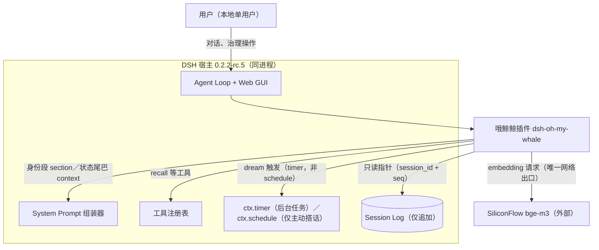
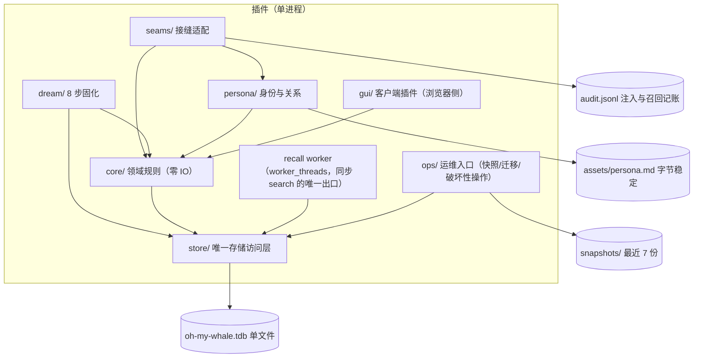
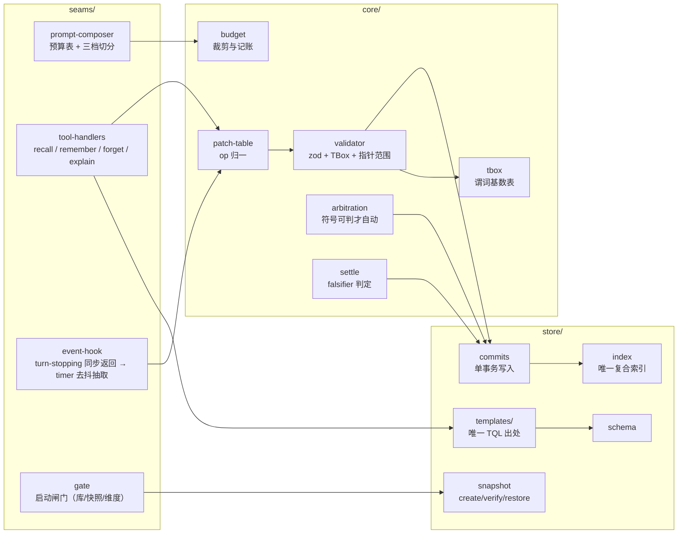
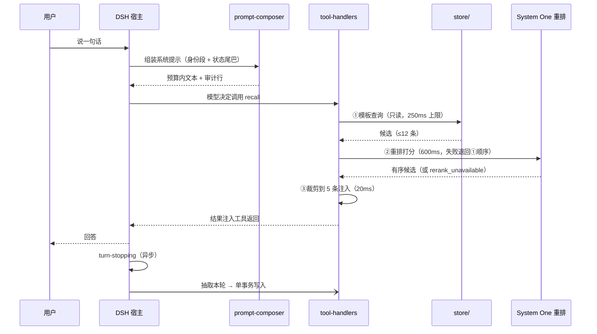
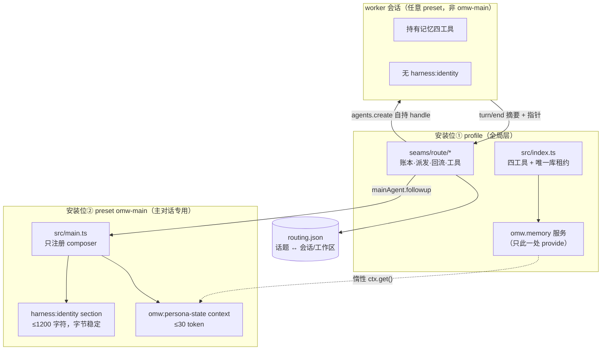

# C4 视图 — DSH 哦鲸鲸

三张图，逐层放大：系统在什么环境里（Context）→ 由哪些可独立部署/独立推演的单元组成（Container）→ 单元内部怎么分（Component）。只画当前存在的和 v1 要建的；Deferred 项不出现。

> **2026-11-25 补记**：本文写于 CAP-9（入口与路由）立项之前，因此 C2/C3 里没有 `src/main.ts`、`core/route/`、`seams/route/`、`presets/`。它们已作为「目标形态」补在文末的 **C5 · 入口与路由** 一节，不进 C2/C3 的既有图——C2/C3 描述的是单安装位形态，把两套形态画在同一张容器图里会让「谁持有库」这件事含糊。`src/govern/` 属 CAP-7（上下文治理），不属 CAP-8（看视频融合，候选、未立项）。

## C1 · 系统上下文

| 元素 | 类型 | 与本系统的关系 |
| --- | --- | --- |
| 用户 | 人 | 只通过 Web GUI 交互，不直连库 |
| DSH 宿主 | 外部系统（同进程） | 提供注入点、工具注册、调度、只读日志；不感知本系统的数据模型 |
| 哦鲸鲸插件 | 本系统 | 全部记忆能力的实现体 |
| SiliconFlow | 外部服务 | 唯一的向量化来源；失败可降级，不阻塞写入 |
| billion-context | 外部插件（不在本系统边界内） | 压缩会遮蔽 surface，但日志保留；本系统只依赖日志 seq，不依赖它 |
| dsh-mnemon | 被替换者 | 迁移后由本系统接管注入，留回滚开关 |

## C2 · 容器视图

| 容器 | 职责 | 能做什么 | 明确不能做什么 |
| --- | --- | --- | --- |
| `seams/` | 把 DSH 的注入点、工具、事件、调度翻译成领域调用 | 调 `core`、调 `persona`、写审计行 | 不写 TQL，不读库 |
| `core/` | 补丁表、校验、裁决、预算、可结算性判定 | 纯函数 | 不做 IO，不 import 宿主类型 |
| `store/` | schema、查询模板、事务提交、索引、快照调用 | 调 TriviumDB | 不 import 其他层 |
| `dream/` | 8 步固化与周期标记 | 调 `core` 与 `store` | 不注册注入，不直接面对用户 |
| `persona/` | 读 `persona.md`、算四维、边界检查 | 纯计算 + 读文件 | 不依赖数据库可用性 |
| `ops/` | 快照、校验、迁移、破坏性操作 | 调 TriviumDB 管理与删除 API | 是唯一允许物理删除与 `tql` 裸查询的地方 |
| `gui/` | 治理视图（flag 队列、版本链、导出） | 通过宿主暴露的通道读数据 | 拿不到 `ctx`，不直连库 |

## C3 · 组件视图（core + store + seams）

| 组件 | 一句话职责 | 关键约束 |
| --- | --- | --- |
| `prompt-composer` | 唯一的注入出口，按预算表切三档 | AD-7：身份段字节稳定；超预算记账 |
| `tool-handlers` | 召回、显式记忆、遗忘、解释「你为什么记得这个」 | AD-8：只读召回；AD-12：边界前置拦截 |
| `event-hook` | 每轮结束触发一次抽取 | AD-18：失败不回滚、不阻塞回合 |
| `gate` | 启动时校验库、快照、维度 | AD-13：任一不过就全停 |
| `validator` | 拒绝不合规补丁并留下证据 | AD-4：拒收写 `rejected` 而非静默丢弃 |
| `arbitration` | 只有一个情形自动裁决 | AD-9：同键 ∧ 区间重叠 ∧ 值不同 |
| `settle` | 让推断被事实判定 | AD-17：无 `falsifier` 不得成为断言 |
| `templates/` | 唯一的 TQL 出处，参数化 | AD-8、AD-15：模板外零 TQL |
| `commits` | 唯一写入口，一个补丁表一个事务 | AD-4：写 API 只在这里出现 |
| `snapshot` | 快照 + 校验 + 恢复 | AD-14：每日 / 迁移前 / 留 7 份 |

## 一次对话的两种视角

## C5 · 入口与路由（CAP-9，目标形态）

这一节单独画，因为它改变的不是组件内部划分，而是**安装形态**：从「一个插件一处安装」变成「两个安装位 + 一处路由」。不要和 C2 叠在一起看。

| 单元 | 安装位 | 能做什么 | 明确不能做什么 |
| --- | --- | --- | --- |
| `src/index.ts`（记忆面） | profile 全局层 | 注册四工具、持有唯一库租约、provide `omw.memory` | **不注册任何 section**（AD-46）；不 import `presets/` |
| `src/main.ts`（人格面） | `omw-main` preset | 注册 `harness:identity` 与 `omw:persona-state`、注册两个派发工具 | **不开库**；`inject` 只许 `systemPrompt`（AD-54）；不得成为 `selectedDefault` |
| `core/route/decide.ts` | 同 profile | 纯函数判定 create/attach/correct | 不碰 ctx、文件、日志（`core-no-seams` 强制） |
| `seams/route/*` | 同 profile | 读写账本、创建/回收 worker、回流摘要 | 不自造 message source kind（AD-52）；不写 `meta.origin:'subagent'` |
| worker 会话 | 由路由创建 | 记忆读写、执行具体工作 | 无身份段、无派发工具；**可被用户接手**（FR-33） |

人格与记忆的可见性边界就是这两张子图之间的线：`harness:identity` 只出现在 `PRESET` 子图里，`omw.memory` 只在 `PROF` 子图里 provide。库坏时 `TAIL` 整段缺席、`SEC` 照常——这是 AD-11 与 I24 守的那条线。
