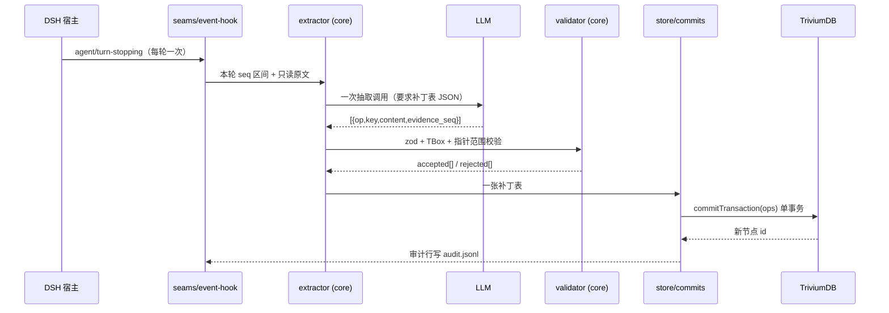

# 方案设计 — DSH 哦鲸鲸

本文件是骨架的下沉：骨架说「什么不允许发生」，这里说「具体怎么做」。凡与骨架冲突，以骨架为准；凡骨架未覆盖，回到 memlog 查裁定过程。

## 1. 目标与非目标

**目标**：让 DSH 里的助手有一个越用越准的长期记忆——记得进、改得动、忘得掉、查得到，并且不拖慢任何一次原生对话。

**非目标（v1 明确不做）**：表达层改写、主动搭话、技能自演进、多用户、跨设备同步、参数化学习。逐条理由见骨架 Deferred。

**设计立场**：这是狗粮项目，不设 KPI 门控；但所有不变量必须是可执行断言（见 §9），不靠人肉记得。

## 2. 数据契约

库是单文件 TriviumDB：节点 = 一条 JSON payload + 一个向量，边 = 带 label 与 weight 的有向边。字段形状由 `store/schema.ts` 的 zod 校验，唯一性由数据库复合唯一索引强制——两件事分工不同，不要混。

### 2.1 节点种类

| kind | 用途 | 关键 payload 字段 |
| --- | --- | --- |
| `assertion` | 一条可判真假的陈述 | `subj, pred, obj, obj_norm?, valid_from, valid_to?, recorded_at, superseded_at?, active_slot(活动=1／失效=毫秒数), origin(observed\|inference), falsifier?, settle_state?, vec_state, actor, cause(conversation\|tool\|dream\|migration), prompt_version, cycle_id?` |
| `evidence` | 指向宿主日志的证据 | `session_id, seq_from, seq_to, quote(≤200), quote_truncated, deidentified` |
| `entity` | 被谈论的对象 | `name, aliases[], type(person\|place\|thing\|org\|topic), first_seen` |
| `episode` | 一段对话的片段 | `title, summary, started_at, ended_at, session_id, seq_from, seq_to` |
| `scene` | 多方收敛出的情境 | `name, description, episode_refs[], confidence` |
| `pref` | 用户偏好（迁移自 mnemon） | `key, value, source{kind,uri,line_from,line_to}, confidence` |
| `persona_state` | 可变关系状态 | `dims{temperature,trust,intimacy,understanding}, updated_at, last_event?` |
| `flag` | 待处理或已处理的标记 | `flag_type(dangling_evidence\|contradiction\|refuted\|rejected\|dream_truncated\|migration), severity, status(open\|resolved), detail, resolved_at?, resolved_by(auto\|human)?` |
| `decision` | 每次改动的账本（谁、依据什么、为什么） | `ts, actor, kind(insert\|supersede\|arbitrate\|resolve_flag\|migrate\|revert), op_id, affected[], target_mem_key, from?, to?, reason, precedent_id?, contract_version` |
| `dream_log` | 固化每一步一条，支持断点续跑 | `date, step, seed, diff, tokens, status` |
| `rejected` | 被校验拒收的补丁 | `patch, reason, at` |
| `dream_cycle` | 固化周期标记 | `date, steps_completed[], tokens_used, truncated` |
| `whatif` | 反事实推演（v1 只建表，不生成） | `hypothesis, falsifier, settle_state, generated_at` |

### 2.2 边标签

| label | 语义 | 方向 |
| --- | --- | --- |
| `supports` / `refutes` | 证据对断言的极性（正向/反向） | evidence → assertion |
| `supersedes` | 新版本取代旧版本 | new → old |
| `contradicts` | 两条互斥断言 | 双向可查 |
| `enriches` | 补充而不取代 | new → old |
| `about` | 任何节点关于某实体 | * → entity |
| `in_episode` | 断言发生在某片段 | assertion → episode |
| `part_of` | 片段属于场景 | episode → scene |
| `derived_from` | 场景由断言归纳而来 | scene → assertion |
| `anchor` | 推演挂靠的事实锚点 | whatif → assertion |
| `covers` | 周期覆盖 | dream_cycle → episode |

`flag` 与 `decision` 都是节点，不是边——治理视图分别靠 `kind=flag ∧ status=open` 和 `kind=decision` 查询。旧写法 `supported_by`（断言→证据）已废弃。

### 2.3 身份：mem_key 与唯一索引

```text
single 谓词：assertion:<subj>:<pred>
multi  谓词：assertion:<subj>:<pred>:<obj_norm>
其它 kind ：<kind>:<稳定名>（entity 用规范化名，pref 用 key，dream_cycle 用日期）
```

`obj_norm` 的规范化：去首尾空白、全角转半角、去标点、英文小写、内部连续空白压成一个。同一规范化结果必须落到同一 key——这是「同一件事只有一条断言」的唯一保证。
唯一性由数据库强制，不靠应用层：`createUniqueCompositeIndex(["mem_key", "active_slot"])`——活动版本写 `active_slot = 1`，被 supersede 时改成 `superseded_at` 的毫秒数，于是 `insert` 与 `updatePayload` 撞键都抛 `TDB_UNIQUE_CONSTRAINT`。历史查询另建普通复合索引 `(mem_key, valid_from)`。节点 id 只是存储局部量（AD-3）；`compareAndSetPayloadField` 不在事务 op 联合里，因此不参与唯一性。补丁表由 core 算出**完整最终 payload**，`store/commits` 单写者串行提交，撞键即写 `rejected`。

只增节点的 key：`decision:<epoch_ms>:<rand>`、`dream_log:<date>:<step>`、`rejected:<epoch_ms>:<hash>`——它们也走同一个唯一索引（`active_slot` 恒为 1），语义上永不被取代。

### 2.4 TBox：谓词基数表

基数决定键，这就是为什么需要一张小 TBox，而不是让模型自由发挥：

| pred | 基数 | 说明 |
| --- | --- | --- |
| `name` | single | 名字只有一个 |
| `lives_in` | single | 换城市 = 旧值 superseded |
| `works_at` | single | 同上 |
| `birthday` | single | |
| `timezone` | single | |
| `likes` | multi | 可喜欢很多东西，键里带 obj |
| `dislikes` | multi | |
| `knows` | multi | 认识谁 |
| `prefers_tone` | single | 说话偏好 |
| `avoids_topic` | multi | 明确不想聊的话题 |

上面这 10 个是**种子**，不是全集：表本身是一份可增长的登记表（`pred` 节点，`mem_key = pred:<规范名>`），基数由数据承担、不由代码常量承担（AD-27）。

- **命中已登记谓词**：按 `cardinality` 决定 `mem_key` 三段（`single`）或四段带 `obj_norm`（`multi`）。
- **未命中**：同一事务内先建 `pred`（`cardinality=multi`、`status=candidate`、`decided_by=model`）再写断言，并挂 `flag_type=predicate_new`；该断言不触发自动裁决（旧版本不被 supersede）。
- **提升为 `single`**：只经用户写入（`kind=pred` 补丁，actor=user），走同一事务与 `decision` 账本、可按 `op_id` 撤销。模型永不写 `single`。
- **非法名**（空、>40 字符、不匹配 `^[a-z][a-z0-9_]*$`、占用 `omw_` 前缀）：整张补丁表拒收并落 `rejected`。
- **防爆**：`tbox.maxNewPredsPerDay` 默认 20，超出则该断言降级为 `scene` 文本并记审计。

## 3. 写入路径



规则要点：

1. **一轮一次，但监听器不等待**：`agent/turn-stopping` 是 `@mode serial`，宿主 await 监听器之后才允许边界提交，所以监听器只做三件事——从 agent 解析 session、把 turn 记进内存待抽取集合、同步返回；真正的抽取由 `ctx.timer` 触发的去抖任务发起，fire-and-forget；失败只记日志，不影响回合结束（AD-18）。
2. **一次 LLM 调用**：抽取与归一化在同一次调用内完成，不搞多轮反思；提示词里带 TBox 与键规则。
3. **补丁优先于全量**：模型输出的是补丁（`insert` / `update` / `supersede`），不是完整记忆；这样写入可以只覆盖变化的部分。
4. **拒收可见**：被拒补丁写 `rejected` 节点而不是静默丢弃（AD-4）。
5. **向量不阻塞**：先落 `vec_state: pending`，异步补（AD-19）。
6. **三个入口共用一条主干**：`remember` 工具、用户显式命令、`turn-stopping` 之后的去抖抽取（`ctx.timer` 每会话一个，默认 3s、max-wait 10s，可关）；抽取只读本轮新增的 seq 区间，不回溯历史、不外扩到别的会话——这是控制「挖料越界」的唯一开关。

## 4. 读取路径：三档注入

| 档 | 内容 | 载体 | 预算 | 变化频率 |
| --- | --- | --- | --- | --- |
| 身份段 | `assets/persona.md` | `systemPrompt.section`（变化会原地替换节点 0、击穿前缀缓存） | ≤1200 字符 | 随发布，几乎不变 |
| 状态尾巴 | 关系四维与档位（≈12）+ 最近一条已确认偏好（≈10）+ 一条待处理 flag（≈8） | `systemPrompt.context`（唯一的 cache-safe 通道） | ≤30 token | 每轮可能变 |
| 按需记忆 | 召回结果 | 工具返回（①worker 线程内 `search` 250ms → ②System One 重排 600ms → ③注入裁剪 20ms） | ≤5 条 / 三段合计 ≤1000ms | 每次提问（重排每轮至多一次） |

三档的区别是变化频率，不是重要性——这正是 cache-safe 的判据：越常变的越晚注入、越靠后。

`seams/prompt-composer.ts` 是唯一出口（AD-7）：它按 `身份 > 状态 > 召回` 的优先级裁剪、把裁剪结果写进审计行（AD-20）。身份段文本先算 sha256，与上次相同就不重写 section，保持字节稳定。
## 5. 固化：dream 的 8 步规格

| 步 | 名称 | 用模型 | 输入 | 输出 | 失败时 |
| --- | --- | --- | --- | --- | --- |
| ① | 确定性结算 | 否 | 过期断言、依赖失效传播、待决承诺、上次 whatif 结算 | `valid_to` / `superseded_at` 置位 | 跳过该条 |
| ② | 重放抽样 | 否 | `importance^0.7 × (surprise+0.1)^0.3` | 候选锚点，一锚点一分叉 | 跳过 |
| ③ | 模式提取 | 是 | 候选锚点 + 相关断言 | 模式候选（diff） | 丢弃该段 |
| ④ | 场景抽象 | 是 | 模式候选 + episode | scene 节点 + `part_of` | 保留 ③ 产物 |
| ⑤ | What-If | 是（v1 关闭） | 先剪过的候选 | whatif 节点，永不进断言层 | 丢弃 |
| ⑥ | 剪枝归档 | 否 | ⑤ 的预测 | 只改 `superseded_at`，可回滚 | 跳过 |
| ⑦ | 跨主题重组 | 否（校验为主） | 跨 scene 的断言 | 新 scene 或 `enriches` 边；解析不到真实 assertion 就整条丢弃 | 丢弃该条 |
| ⑧ | 策略提炼 | 是 | 失败先归因到单个条目 | 文本策略候选 + 闸门 | 保留原版 |

①②⑥⑦ 不调模型；③④⑤⑧ 是模型步骤，产物必须能解析、能 diff、能丢弃——这是「确定性结算先行」的具体含义。每步单独提交一个 `dream_log` 节点（阶段、种子、diff、tokens），所以中断后从最后完成的阶段续跑，而不是重跑整夜；同一个坑不会因为一次崩溃连踩两晚。

幂等：`dream_cycle:<date>` 由唯一索引保证一天一次；同日二次运行直接退出。预算：按段计 token，日上限命中即停在段边界并置 `dream_truncated`。`--dry-run` 只跑 ①② 并产出 diff 文件，不提交任何 op。

⑤ 即使将来打开，约束也已经写死：深度 ≤2、默认 K=1、一锚点一分叉、先剪候选、产物永不进断言层。

## 6. 治理模型

**版本链**：给定 `mem_key`，按 `recorded_at` 升序取出链条，链上每一环都带 `superseded_at`，最后一环为空。链是只增的，不可剪断。

**两个时间查询入口**（都在 `store/templates/`）：

```text
validAt(t)     : valid_from <= t AND (valid_to IS NULL OR valid_to > t)
                 —— 「那时世界上的事实是什么」
knownAsOf(t)   : 上式 AND recorded_at <= t
                 —— 「在那时我们已知什么」，用于复盘当时为何那样回答
```

两者都不带 `superseded_at IS NULL`：它们是历史查询；默认查询才带（AD-5）。

**flag 生命周期**：`status` 只有 `open` 与 `resolved` 两个值，谁解的记在 `resolved_by`（`auto` / `human`）；flag 本身不删除。自动档只有 AD-9 那一种情形；其余一律 `open`，等人。治理队列的查询就是 `kind=flag ∧ status=open`。

**软删除**：置 `superseded_at` + `flag(deleted)` + 一个 `decision` 节点，导出时仍出现但标注为已删除。**任何路径都不物理删除断言**（AD-5：`delete(` / `deleteManyAtomic(` / `unlink(` 与事务 op `type:'delete'|'unlink'|'unlinkLabel'` 全仓禁止；快照清理删的是目录，不需要这些 API）；撤销 = 在同一事务里整体重写受影响 payload，把 `superseded_at` 与 `active_slot` 还原成撤销前的值（事务 op 只有整体替换的 `updatePayload`，能 `$unset` 的 `patchPayload` 不是事务 op），所以「删错了」可以逐条回滚，而不用整库回滚。

**决策账本**：每次改动在同一个事务里追加一个 `decision` 节点。它让治理能回答三个问题——谁改的（actor）、依据什么（reason 与 evidence 指针）、有没有前例（precedent_id）。先例只影响建议排序，不自动改数据。

**撤销单元**：一条 `decision` 同时携带 `op_id` 与 `affected[]`——受影响的 `mem_key` 集合，加受影响的边（用 `(from_key, label, to_key)` 表达，绝不用节点 id）。撤销就是按 `op_id` 反向生成一张补丁表、在一个事务里执行、再追加一条 `decision(kind=revert)`。复合操作整体撤或整体不动，不允许撤一半。验收口径是「撤销后默认查询与召回结果逐条等于操作前」，不是「快照能恢复」。

**导出**：两份。JSONL 每行一个节点（含 kind 与边列表，不含节点 id）；纯文本版按 scene 分组，供人直接读。导出是「记忆可被带走」的最低承诺。

## 7. 人格与关系

`assets/persona.md` 四段，顺序固定，字节稳定：

1. **身份**：鲸鲸是谁、与用户是什么关系形态（形状参考「他她」）。
2. **说话方式**：句长、语气、用词习惯、什么情况下简短。
3. **边界**：明确不做什么（见下）。
4. **她不是谁**：防止滑向通用助手腔或客服腔。

四维更新的分类表（工具层事件 → 维度增量，步长由 intensity 调制）：

| 事件类 | 主要维度 | 方向 |
| --- | --- | --- |
| 用户主动分享私事 | intimacy / trust | + |
| 用户纠正她并接受 | understanding | + |
| 用户冷淡或拒绝 | temperature | − |
| 她记错并被指出 | understanding | − |
| 长时间未互动 | temperature | 缓慢回落 |

三档（`<45 / 45–69 / ≥70`）只改变行为约束——称呼、主动程度、私密话题的开放度——不写具体台词。台词是模型的事，架构只管约束。

边界硬拦截四类，在工具 `execute` 之前执行（AD-12），返回结构化的拒绝而不是让模型自我克制：自伤与危机、越界亲密、法律医疗的确定性建议、索取他人隐私。

## 8. 降级矩阵

| 故障 | 检测点 | 行为 | 用户可见 | 恢复 |
| --- | --- | --- | --- | --- |
| 库打不开 / verify 失败 / dim 不符 | 启动闸门 | 整体 no-op（AD-13） | 无记忆的 DSH，功能照常 | 重载插件 |
| embedding 超时或报错 | 写后补写 | 保持 `pending`，召回走文本 + 图 | 无感 | 下次补写 |
| 抽取 LLM 失败 | 写入路径 | 本轮不写，记一行日志 | 无感（这轮没记住） | 下一轮自然补 |
| dream 超预算 | 段边界 | 停在边界，置 `dream_truncated` | 无感 | 次日继续 |
| 工具注册失败 | 启动 | 注入照常（AD-18） | 少几个工具 | 重载插件 |
| 快照失败 | ops 前置检查 | 阻断破坏性操作 | 明确报错 | 修好后重试 |

## 9. 可执行不变量

这些是「架构真的落地了」的判据，每一条都要有对应测试或脚本，不允许只写在文档里：

| # | 断言 | 检查方式 |
| --- | --- | --- |
| I1 | 默认查询永不返回 `superseded_at` 非空的节点 | 契约测试：造新旧两版，只查得到新版 |
| I2 | 全仓零物理删除（快照清理除外） | CI grep（AD-15） |
| I3 | 每轮注入不超预算，且审计行可复算 | 用审计行重算 tokens，与预算表比对 |
| I4 | 召回在 1000ms 硬上限内返回候选，且**②失败不返空** | ①在 worker 线程跑、主线程只等 `recall.timeoutMs`；分别注入慢 provider 与坏 provider：前者断言走完①并按 `rerank_unavailable` 退回①顺序，后者断言①真空才记真空降级 |
| I5 | dream 同日二次运行无 diff | dry-run 两次，diff 为空 |
| I6 | 库不可用时零注册 | 用坏文件启动，断言 section 与工具都未注册 |
| I7 | 无 `falsifier` 的推断不入库 | 提交带 `origin=inference` 且无 falsifier 的补丁，断言进 `rejected` |
| I8 | 快照可用 | `verifySnapshot` 返回 `complete=true` 且文件 crc 匹配 |
| I9 | 身份段字节稳定 | 连续 100 轮注入，section 文本 sha256 不变 |
| I10 | 证据指针可回读 | 取一条 evidence，按 `session_id + seq` 从只读日志读回原文 |
| I11 | dream 中断可从最后完成的阶段续跑 | 在第 ④ 步后杀进程，重启后断言 ①②③ 不重跑 |
| I12 | 治理能答「谁改的、为什么」 | 任取一条断言，沿 `decision` 链答出 actor / reason / 时间 |
| I13 | 撤销单元整体回滚 | 造一次复合操作（supersede + flag + 边），按 `op_id` 撤销，默认查询与召回逐条等于操作前（比较时排除账本类节点） |
| I14 | 插件能被真正启用并注入一次 | G0-5：重启后 `omw doctor` 全绿，且注入段在宿主里可见 |
| I15 | 三项 p95 达标 | `scripts/audit-report.mjs --since 24h`：注入 ≤30ms、召回 ≤900ms 且 `rerank_unavailable` <5%、①真空 <1%、写事务 ≤10ms |

## 10. 里程碑

| 里程碑 | 内容 | 出口条件 |
| --- | --- | --- |
| M0 打通 | 八道闸门 G0-1…G0-8：原生模块加载（已实测通过）、bge-m3 维度实测（已通过：1024，255–408ms）、日志 seq 可回读（已实测通过：seq 连续缺号 0）、最小注入闭环、插件真正启用、TS7+eslint 跨层拦截可用、SystemOne 打分通道与断网降级、固化提炼与核验两个模型 id 可用 | **八项全过才往下走**，任一失败就回退方案而不是硬撑 |
| M1 契约与写入 | schema、TBox、补丁校验、单事务写入、rejected | I7 通过；20 条黄金用例写入正确 |
| M2 读取 | 三档注入、预算、召回模板、审计 | I1、I3、I4、I9、I10 通过 |
| M3 固化 | 8 步（dry-run 先行）、幂等、预算 | I5 通过；dry-run diff 人工审过 3 轮 |
| M4 治理与人格 | 版本链、flag 队列、导出、关系四维、边界 | I6 通过；治理 20 问能答 |
| M5 界面与迁移 | 治理视图、mnemon 迁移、回滚开关 | 迁移幂等；`legacyMnemonInject` 可一键回退 |

## 11. 与简报四个成功标准的对照

| 标准 | 怎么算达成 | 依赖 |
| --- | --- | --- |
| 记忆精度 ≥80%（50 条抽样） | 人工抽样判定，不做自动评分器 | AD-6 证据可追 + AD-17 可结算 |
| 治理 20/20 在 30s 内答 | 计时 + 人工确认答案正确 | AD-5 + AD-9 + 版本链查询 |
| 遗忘回滚 10/10 零残留 | 软删除后默认查询与召回都不出现；撤销后逐条复原 | AD-5 + AD-22 |
| 注入成本可控 | 审计行可复算，且 DSH 原有任务不退化 | AD-7 + AD-20 |

## 12. 契约摘要（实现者先读这一节）

| 面 | 定成什么 | 出处 |
| --- | --- | --- |
| 工具 | `recall(query, topK?≤8)`、`remember(patch)`、`forget(mem_key, reason)`、`explain(mem_key)`；统一包封 `ok / items? / degraded / reason?` | AD-25 |
| 错误码 | `E_BUDGET` `E_TIMEOUT` `E_DEGRADED` `E_BOUNDARY` `E_GATE_DOWN` | AD-25 |
| 治理投影 | `core/projections` 的纯函数 DTO（`flagQueue`/`versionChain`/`exportJsonl`/`explain`），带 `contractVersion`，经 `seams/projection-bridge` 给客户端 | AD-24 |
| 配置 | 唯一 schema 在 `seams/config.ts`，互斥规则启动即校验；预算三键封顶外部调用 | AD-26 |
| 注入 | 身份段 `section()`、状态尾巴 `context()`；`compose()` p95 ≤20ms，审计异步 | AD-7、AD-20 |
| 召回 | ①worker 线程内 `search()` 250ms → ②重排 600ms（每轮至多一次、缓存 10 分钟）→ ③注入 20ms；硬上限 1000ms、②失败退①不返空 | AD-8 |
| 写 | 单写队列 `store/commits/queue.ts`，一次业务写入一次事务，撞唯一键即 `rejected` | AD-4、AD-3 |

## 13. 遗留风险

1. **原生模块加载**：`triviumdb.win32-x64-msvc.node` 需与 DSH 运行时的 Node ABI 匹配。M0 首关，不通过就没有后续。
2. **单写者**：单文件库在插件内串行化写入；不跨进程，但 dream 与对话写入要排队（同一事件循环内串行提交即可）。
3. **中文规整**：`obj_norm` 只能处理形近，处理不了同义（「上海」与「魔都」）。同义归并留给 dream 第 2 步与人工锚点。
4. **抽取成本**：每轮一次 LLM 调用，长对话会累积；按轮次上限而非字数上限来控制。
5. **网络依赖**：embedding 走公网，延迟与失败率不可控——这正是不让它阻塞写入的原因。
