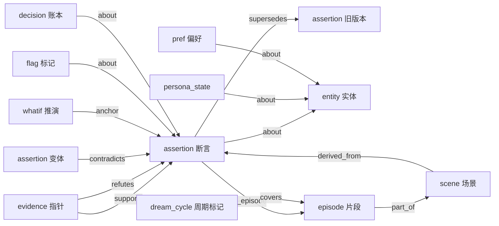

# 数据模型与时序语义

> 形状出处：方案设计 §2（`sources:` 里已吸收）与骨架 AD-3 / AD-5 / AD-21 / AD-22。凡与骨架冲突以骨架为准。本文件是 FR-1…FR-4、FR-11…FR-14 的落地形状。

## 1. 时间轴与「未失效」

每条断言同时具备：世界时间 `valid_from` / `valid_to`（半开区间 `[valid_from, valid_to)`）、记录时间 `recorded_at`、失效时间 `superseded_at`。

- **未失效时不写 `superseded_at`、也不写 null**；一切查询用 `superseded_at: {$exists: false}` 表达「未失效」。
- 该过滤器只在 `store/filters.ts` 的 `liveOnly()` 一处构造。`$exists` 未进 triviumdb 0.9.3 的类型声明 → 本地放宽 `FilterOperator` 并钉死版本，M0 补一条语义测试。
- 历史查询显式传 `validAt(t)`（那时世界上的事实）或 `knownAsOf(t)`（那时我们已知什么），两者都不带 superseded 过滤。
- 兑现 FR-3 / FR-4 与不变量 I1。

## 2. 身份：`mem_key` 与唯一索引

```text
single 谓词：assertion:<subj>:<pred>
multi  谓词：assertion:<subj>:<pred>:<obj_norm>
其它 kind ：<kind>:<稳定名>（entity 用规范化名、pref 用 key、`pred` 用谓词规范名、dream_cycle 用日期）
只增节点 ：decision:<epoch_ms>:<rand>、dream_log:<date>:<step>、rejected:<epoch_ms>:<hash>
```

- **`obj_norm` 规范化**：去首尾空白、全角转半角、去标点、英文小写、内部连续空白压成一个。算法带 `norm_version` 并写进 payload；换算法必须走一次 `ops/rekey` 迁移（先快照、每条改动写 `decision`），禁止静默升级。
- **唯一性由数据库强制**：`createUniqueCompositeIndex(['mem_key','active_slot'])`。活动版本 `active_slot = 1`，被 supersede 时写成 `superseded_at` 的毫秒数，于是 `insert` 与 `updatePayload` 撞键都抛 `TDB_UNIQUE_CONSTRAINT`；抛错即写 `rejected`，不靠 CAS。历史查询另建普通复合索引 `(mem_key, valid_from)`。
- **节点 id 是存储局部量**：禁止进导出、配置、运行日志、flag 负载；跨版本引用只许用 `mem_key`。
- **已知限制**：`obj_norm` 只处理形近，处理不了同义（「上海」/「魔都」）；同义归并留给 dream ② 与人工锚点，v1 不承诺。

## 3. 节点 kind（14 个）

| kind | 用途 | 关键 payload |
| --- | --- | --- |
| `assertion` | 一条可判真假的陈述 | `subj, pred, obj, obj_norm?, valid_from, valid_to?, recorded_at, superseded_at?, active_slot, origin(observed\|inference), falsifier?, settle_state?, vec_state, actor, cause(conversation\|tool\|dream\|migration), prompt_version, cycle_id?` |
| `evidence` | 指向宿主日志的证据 | `session_id, seq_from, seq_to, quote(≤200), quote_truncated, deidentified` |
| `entity` | 被谈论的对象 | `name, aliases[], type(person\|place\|thing\|org\|topic), first_seen` |
| `episode` | 一段对话的片段 | `title, summary, started_at, ended_at, session_id, seq_from, seq_to` |
| `scene` | 多方收敛出的情境 | `name, description, episode_refs[], confidence` |
| `pref` | 用户偏好 | `key, value, source{kind,uri,line_from,line_to}, confidence` |
| `persona_state` | 可变关系状态 | `dims{temperature,trust,intimacy,understanding}, updated_at, last_event?` |
| `flag` | 待处理或已处理的标记 | `flag_type, severity, status(open\|resolved), detail, resolved_at?, resolved_by(auto\|human)?` |
| `pred` | 谓词登记：基数、别名与状态 | `pred, cardinality(single\|multi), status(active\|candidate\|deprecated), aliases[], decided_by(user\|seed\|model), decided_at, evidence_count, norm_version` |
| `decision` | 每次改动的账本 | `ts, actor, kind(insert\|supersede\|arbitrate\|resolve_flag\|migrate\|revert), op_id, affected[], target_mem_key, from?, to?, reason, precedent_id?, contract_version` |
| `dream_log` | 固化每一步一条，支持断点续跑 | `date, step, seed, diff, tokens, status` |
| `rejected` | 被校验拒收的补丁 | `patch, reason, at` |
| `dream_cycle` | 固化周期标记 | `date, steps_completed[], tokens_used, truncated` |
| `whatif` | 反事实推演（v1 只建表，不生成） | `hypothesis, falsifier, settle_state, generated_at` |

## 4. 边 label（11 个）

| label | 语义 | 方向 |
| --- | --- | --- |
| `supports` / `refutes` | 证据对断言的极性 | evidence → assertion |
| `supersedes` | 新版本取代旧版本 | new → old |
| `contradicts` | 两条互斥断言 | 双向可查 |
| `enriches` | 补充而不取代 | new → old |
| `about` | 任何节点关于某实体 | * → entity |
| `in_episode` | 断言发生在某片段 | assertion → episode |
| `part_of` | 片段属于场景 | episode → scene |
| `derived_from` | 场景由断言归纳而来 | scene → assertion |
| `anchor` | 推演挂靠的事实锚点 | whatif → assertion |
| `covers` | 周期覆盖 | dream_cycle → episode |

`flag` 与 `decision` 都是**节点**不是边——治理视图分别靠 `kind=flag ∧ status=open` 与 `kind=decision` 查询；旧写法 `supported_by`（断言→证据）已废弃，统一用 evidence → assertion 的 `supports` / `refutes` 表达极性。

## 5. 谓词登记表（开放集合）

> **已裁决（2026-11-23）**：谓词表**不再是代码白名单**。谓词是数据——每次落盘先读一次登记表，模型判断现有谓词是否够用，不够就新建一条。表里的 10 个只是随插件安装写入的**种子谓词**，不是封闭集合。

| pred | 基数 | 说明 |
| --- | --- | --- |
| `name` | single | 名字只有一个 |
| `lives_in` | single | 换城市 = 旧值 superseded |
| `works_at` | single | 同上 |
| `birthday` | single | |
| `timezone` | single | |
| `likes` | multi | 可喜欢很多东西，键里带 obj |
| `dislikes` | multi | |
| `knows` | multi | 认识谁 |
| `prefers_tone` | single | 说话偏好 |
| `avoids_topic` | multi | 明确不想聊的话题 |

**表在哪**：每个谓词是一条 `pred` 节点（`mem_key = pred:<规范名>`），payload 见 §3；只增不删，基数变更 = 旧节点置失效 + 新节点 + `decision` 账本（AD-22 可撤销）。`store/tbox.ts` 里只剩两样东西：谓词名的合法性规则与 falsifier 的字段白名单（`valid_to`、`superseded_at`、`evidence.count`、`flag.status` 等——字段名是属性名，仍是代码常量）。

**每次落盘先取表**：一次事务开始时读一份登记表快照（进程内缓存，提交后失效），后续 op 用这份快照决定 `mem_key` 形态与冲突判定，不在事务中途重读。

**命中与未命中**：

1. 提案的 `pred` 先规范化——小写、去首尾空白与标点、连续空白压成一个，再查 `aliases[]` 合并到规范名（v1 只合并显式声明的同义，不做语义联想）。
2. 命中表内谓词：按其 `cardinality` 决定 `mem_key` 是三段还是四段，并据此判定冲突。
3. 未命中：在同一事务内先插一条 `pred` 节点（`cardinality=multi`、`status=candidate`、`decided_by=model`），再插断言，并挂一条 `flag_type=predicate_new` 的挂起标记。**默认 `multi` 是关键**：AD-9 的自动裁决只在 `single` 上成立，所以新谓词不可能一出生就替用户驳回旧断言。
4. 谓词名非法（空、>40 字符、不匹配 `^[a-z][a-z0-9_]*$`、占用保留前缀 `omw_`）：该 op 拒收、整张补丁表不落、写 `rejected`。
5. 防爆：`tbox.maxNewPredsPerDay`（默认 20）。超出后新谓词不再创建，该断言降级为 `scene` 描述文本并记一行审计——信息不丢，但不进断言层。
6. 提升为 `single` 只由**用户**发起：一条 `kind=pred` 的普通写入（actor=user，走同一事务与账本，可撤销）。模型无权写 `single`；AD-9 的「谓词基数为 single」因此永远指「有人声明过的 single」，符号可判性不被模型的自造词削弱。

**不参与召回**：`pred` 节点不进注入、不进召回候选，只在导出时作为词表段输出。

## 6. 决策账本与撤销闭包

- 每次改动（写入、自动裁决、人工裁定、迁移）在**同一事务**内写一个 `decision` 节点，字段见 §3；人工裁定可指定 `precedent_id` 复用可撤销先例，先例只影响建议排序、不自动改数据；`decision` 只增、不改、不删。
- 断言自身也必须带来源：`actor`、`cause`、`prompt_version`，dream 产物另带 `cycle_id`——否则「这条是哪版提示词生成的」永远答不出来。
- **`affected[]` 闭包** = 该操作写入或改动的全部**状态**节点与边（断言、flag、scene、evidence，以及 `supersedes` / `contradicts` / `part_of` 这些边；边以 `(from_key, label, to_key)` 表达，绝不用节点 id）。账本类（`decision`、`dream_log`、`rejected`、`dream_cycle`）不在闭包内，也永不撤销。
- 撤销 = 按 `op_id` 反向生成补丁表、在**一个事务**里执行（事务 op 只有整体替换的 `updatePayload`，能 `$unset` 的 `patchPayload` 不是事务 op），并追加一条 `decision(kind=revert, precedent_id=原 op_id)`。

## 7. 标记（flag）生命周期

- 按方案设计的形状：`status ∈ {open, resolved}`，`resolved_by ∈ {auto, human}`，`flag_type ∈ {dangling_evidence, contradiction, refuted, rejected, dream_truncated, migration}`。
- `flag` 是节点不是边；治理队列查询 = `kind=flag ∧ status=open`；flag 本身不删除。
- 自动档只有 AD-9 那一种情形（`status=resolved, resolved_by=auto`）；其余一律 `open`，等人。
- **已裁决（2026-11-23）**：PRD FR-12 的「创建 / 挂起 / 已解决 / 已证伪 / 已撤销」是 status 与 `flag_type` 的混写。定案按本节两态 + `flag_type` + `resolved_by` 记录——创建与挂起都是 `open`；已解决是 `resolved` + `resolved_by(auto|human)`；已证伪是 `flag_type=refuted`；已撤销由 `decision(kind=revert)` 表达，flag 本身不设 `revoked` 状态。新增 `flag_type=predicate_new` 用于承接口径开放后的新谓词提案。

## 8. L0–L3 分层映射

| 层 | 是什么 | 落在哪 | 注入方式 |
| --- | --- | --- | --- |
| L0 原始 | 宿主会话日志，只追加、不可改 | 宿主 session log | 不注入，只作证据指针（AD-6） |
| L1 断言 | 一条可判真假的陈述 + 证据 | `assertion` + `evidence` 节点 | 按需召回，≤5 条 |
| L2 场景 | 多轮归纳出的情境 | `episode` + `scene` 节点 | 按需召回，永不常驻 |
| L3 画像 | 稳定人格与偏好 | `assets/persona.md`（身份）+ `pref` 节点（偏好） | 身份段 ≤1200 字符；偏好最多 1 条进 30 token 尾巴 |

验收里说的「L1 抽样」即 `assertion` 节点。这是对简报「L3 整篇重写」的显式替代。

## 9. 节点与边形状



## 10. 格式与命名约定

- 时间一律 ISO-8601 UTC 带毫秒；有效期半开区间 `[valid_from, valid_to)`；记账 `{ts, kind, tokens, items, actor}`。
- 错误 `{code, message, detail?}`；运行时错误码 8 个（`OMW_*`），工具错误码 5 个（`E_*`），两套不混用。
- 导出 = 纯文本 + JSONL，不含节点 id，默认不含已脱敏引文。
- kind 与 edge label 用 snake_case；文件名 kebab-case；`mem_key` 格式见 §2；CAP-n 与 AD-n 编号永不复用、永不重排。
- 审计形如 `audit-YYYYMMDD.jsonl`（按天切分、保留 30 天、只落文件）：注入行 `{ts, session_id, tier, chars, tokens, items[], truncated, prefix_unchanged, host_cache_read, host_cache_write, host_uncached}`；召回行 `{ts, query_hash, topK, hits[], elapsed_ms, degraded, degraded_reason[]}`，`degraded_reason` 取值封闭为 `recall_timeout | rerank_unavailable | rerank_circuit_open | vec_unavailable | embed_circuit_open | budget_truncated`。
