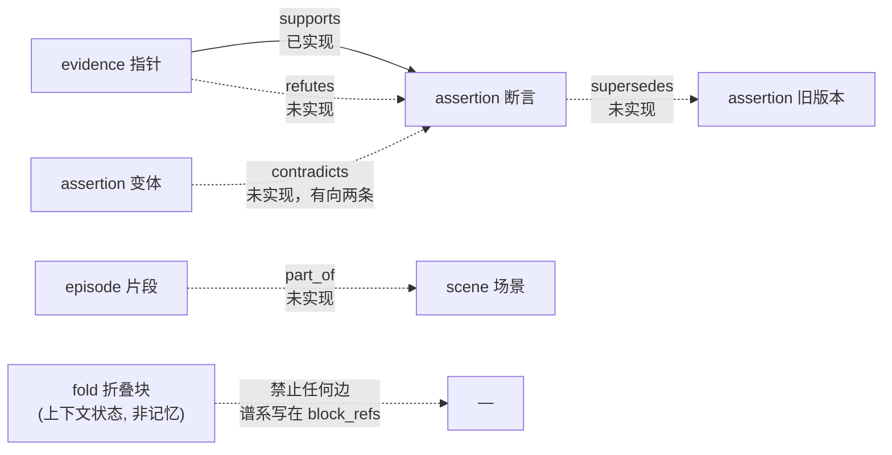

# 数据模型与时序语义

> 形状出处：方案设计 §2（`sources:` 里已吸收）与骨架 AD-3 / AD-5 / AD-21 / AD-22；CAP-7 的两个新 kind 出自 `CONTEXT-GOVERNANCE.md` §7（行 229–234），CAP-9 的 `routing.json` 出自 `entry-routing.md`。凡与架构冲突以架构为准。本文件是 FR-1…FR-4、FR-11…FR-14 的落地形状，2026-11-25 补入扩展组（FR-34…FR-77）引入的字段与新 kind。
>
> **两条时间轴记号**：本文件的 `L0–L3` 指**记忆分层**（§8）。上下文治理的「第 0 级 / 第 1 级」是**折叠阶梯**，与记忆分层无关，两套记号不得混用。

## 1. 时间轴与「未失效」

每条断言同时具备：世界时间 `valid_from` / `valid_to`（半开区间 `[valid_from, valid_to)`）、记录时间 `recorded_at`、失效时间 `superseded_at`。

- **未失效时不写 `superseded_at`、也不写 null**；一切查询用 `superseded_at: {$exists: false}` 表达「未失效」。
- 该过滤器只在 `store/filters.ts` 的 `liveOnly()` 一处构造。`$exists` 未进 triviumdb 0.9.3 的类型声明 → 本地放宽 `FilterOperator` 并钉死版本，M0 补一条语义测试。
- 历史查询显式传 `validAt(t)`（那时世界上的事实）或 `knownAsOf(t)`（那时我们已知什么），两者都不带 superseded 过滤。
- 兑现 FR-3 / FR-4 与不变量 I1。

## 2. 身份：`mem_key` 与唯一索引

```text
single 谓词：assertion:<subj>:<pred>
multi  谓词：assertion:<subj>:<pred>:<obj_norm>
其它 kind ：<kind>:<稳定名>（entity 用规范化名、pref 用 key、`pred` 用谓词规范名、dream_cycle 用日期）
只增节点 ：decision:<epoch_ms>:<rand>、dream_log:<date>:<step>、rejected:<epoch_ms>:<hash>
```

- **`obj_norm` 规范化**：去首尾空白、全角转半角、去标点、英文小写、内部连续空白压成一个。算法带 `norm_version` 并写进 payload；换算法必须走一次 `ops/rekey` 迁移（先快照、每条改动写 `decision`），禁止静默升级。
- **唯一性由数据库强制**：`createUniqueCompositeIndex(['mem_key','active_slot'])`。活动版本 `active_slot = 1`，被 supersede 时写成 `superseded_at` 的毫秒数，于是 `insert` 与 `updatePayload` 撞键都抛 `TDB_UNIQUE_CONSTRAINT`；抛错即写 `rejected`，不靠 CAS。历史查询另建普通复合索引 `(mem_key, valid_from)`。
- **节点 id 是存储局部量**：禁止进导出、配置、运行日志、flag 负载；跨版本引用只许用 `mem_key`。
- **已知限制**：`obj_norm` 只处理形近，处理不了同义（「上海」/「魔都」）；同义归并留给 dream ② 与人工锚点，v1 不承诺。

## 2.1 计数一律从 `evidence` 边算（2026-11-25 定案）

库里**不存在任何可变计数器字段**。凡需要「遇到过几次 / 被独立见过几次 / 支持几条」的地方，一律在**读时**对断言上的 `evidence` 边计数：

- `evidence` 边按 `source_independence` 去重——两条证据算**同一来源** ⟺ 指向同一宿主 `session_id`，**或**规范化后的引文前缀（前 80 字符）完全相同。同源多条只算 1。
- FR-34 的精确去重**不新建断言节点**，但重复命中要**追加一条指向本次 `source seq` 的 `evidence` 边**；因此「重复陈述 10 次」可两头核：断言节点净增 1、该断言的 `evidence` 边净增 10（同源去重后按实际来源数）。
- §3 里的 `pred` 节点曾有一个 `evidence_count` 字段，想表达「这个谓词被多少断言用过」。它已按 §7.1 删除：该值恒为 0、全仓无任何自增路径，读时从断言聚合即可，不必也不该进库。

**为什么不用计数器**：写入侧去重会吃掉重复（FR-34 命中就不写新条），若另存计数器又只在写入路径自增，恢复快照后计数与库不同步；而 `evidence` 边随断言一起进出快照，天然一致。与 FR-36「热度只算不写回」同向。

## 3. 节点 kind（16 个）

| kind | 用途 | 关键 payload |
| --- | --- | --- |
| `assertion` | 一条可判真假的陈述 | `subj, pred, obj, obj_norm?, valid_from, valid_to?, recorded_at, superseded_at?, active_slot, origin(observed\|inference), falsifier?, settle_state?, vec_state, actor, cause(conversation\|tool\|dream\|migration), prompt_version, cycle_id?, derivation?, rule_id?, justification_id?, depth?` |
| `evidence` | 指向宿主日志的证据 | `session_id, seq_from, seq_to, quote(≤200), quote_truncated, deidentified` |
| `entity` | 被谈论的对象 | `name, aliases[], type(person\|place\|thing\|org\|topic), first_seen` |
| `episode` | 一段对话的片段 | `title, summary, started_at, ended_at, session_id, seq_from, seq_to` |
| `scene` | 多方收敛出的情境 | `name, description, episode_refs[]`（**无 `confidence`**：可信度读时由边现算，见 §7.1） |
| `pref` | 用户偏好 | `key, value, source{kind,uri,line_from,line_to}, confidence` |
| `persona_state` | 可变关系状态 | `dims{temperature,trust,intimacy,understanding}, updated_at, last_event?` |
| `flag` | 待处理或已处理的标记 | `flag_type, severity, status(open\|resolved), detail, resolved_at?, resolved_by(auto\|human)?` |
| `pred` | 谓词登记：基数、别名与状态 | `pred, cardinality(single\|multi), status(active\|candidate\|deprecated), aliases[], decided_by(user\|seed\|model), decided_at, norm_version`（**无 `evidence_count`**：见 §7.1） |
| `decision` | 每次改动的账本 | `kind`（恒为 `'decision'`，节点判别）+ `decision_kind(insert\|supersede\|arbitrate\|resolve_flag\|migrate\|revert)`, `ts, actor, op_id, affected[], target_mem_key, from?, to?, reason, precedent_id?, contract_version` |
| `dream_log` | 固化每一步一条，支持断点续跑 | `date, step, seed, diff, tokens, status` |
| `rejected` | 被校验拒收的补丁 | `patch, reason, at` |
| `dream_cycle` | 固化周期标记 | `date, steps_completed[], tokens_used, truncated` |
| `whatif` | 反事实推演（v1 只建表，不生成；四字段 2026-11-25 补） | `hypothesis, falsifier, settle_state, generated_at, edit_op?, predicted_delta?, verified_at?, outcome?` |
| `fold` | 一次折叠产生的上下文块（**不是记忆**，AD-37 三条禁令专指它） | `session_id, seq_from, seq_to, tier, topic, summary, sections, req_refs[], block_refs[], dropped[], tokens_before, tokens_after, bytes_before, bytes_after, prompt_version, contract_version, status(active\|expanded\|superseded), degraded?` |
| `req_ledger` | 会话级要求账本，每会话一条 | `session_id, items[{seq, kind(goal\|constraint\|prohibition\|authorization\|scope), text_norm, status(active\|retired\|superseded), source_seq}], updated_seq, contract_version` |

### 3.1 两个上下文治理 kind 的三条禁令与身份

`fold` 与 `req_ledger` 是**上下文状态，不是记忆**。三条禁令（AD-37）写死在这里，因为它们决定了 `data-model` 的形状：

1. **记忆抽取只读 L0 原始日志的 seq 区间**，禁止以 `fold` 节点或其摘要文本作为抽取输入（摘要可能幻觉，抽取不能建立在幻觉上）。
2. **检查点里的事实只能是「本会话已发生的事」**，禁止把召回结果写进检查点（否则检查点变成第二份记忆）。
3. **`fold` 节点不进召回、不进注入、不进 `exportJsonl`、不参与 dream 的任何一步**；只有 `context_search` 与治理视图能读它。反过来允许：记忆的证据指针指向 seq，而折叠不改 seq——**折叠对记忆模块完全透明**，这是两个模块能共存的结构原因。

`mem_key` 用业务身份（AD-3）：`fold:<session_id>:<seq_from>`、`req_ledger:<session_id>`。两者都不依赖节点 id，重建库后仍可对上。**不新增边**——块的谱系写在 `fold.block_refs` 里；被折区间是 seq 坐标不是节点，硬造一条指向区间的边只会让图模式失真。

两种「用户说过的话」分工不同：记忆的 `pref` 是**跨会话、可结算**的长期偏好；`req_ledger` 是**会话级、随会话失效**的当前任务约束。同一句话可以同时进两处，但只有 `pref` 会被 dream 结算、被跨会话召回；会话结束时账本不复制进记忆——抽取仍从 L0 读。

### 3.2 证明四列（FR-40）

`derivation` / `rule_id` / `justification_id` / `depth` 四列**写入即定、不可改写**，缺列拒收。

- 首列叫 `derivation` 而不是 `origin`：`origin` 已被占用为 `observed | inference` 二值（AD-17 据它要求 `origin=inference` 必带 `falsifier` / `settle_state`）。`derivation ∈ {rule, dream} ⇒ origin = inference`。存量断言标 `origin=observed` 且四列留空。
- `justification_id = sha256(sorted(前提业务键集合))`——**按业务键算，不含节点 id**，因此重建库后同一证明得到同一 `justification_id`。
- `depth` 是推导深度；超过上限即拒收，防止链式推导无限展开。

**为什么必须现在做**：推导事实不存历史，事后补 `rule_id` 意味着全部历史推导无法溯源。这是扩展组里唯一「现在不做以后做不了」的项。

## 4. 边 label（v1 封闭集 5 条）

**封闭集**（2026-11-26 定案，P0-6）：`supports` / `refutes` / `supersedes` / `contradicts` / `part_of`。代码常量在 `src/store/templates/evidence.ts` 的 `EDGE_LABELS`，`PlannedLink.label` 的类型就是它——封闭集之外的值在编译期与提交期都进不来。

| label | 语义 | 方向 | 实现状态 |
| --- | --- | --- | --- |
| `supports` | 证据支持断言 | evidence → assertion | **已实现**：`SUPPORTS_LABEL`，写入点在 `src/seams/write-port.ts:632`，读法在 `evidence.ts:56` |
| `refutes` | 证据反驳断言 | evidence → assertion | 未实现，首建方 Story 3.3（自动档裁决） |
| `supersedes` | 新版本取代旧版本 | new → old | 未实现，首建方 Story 3.4（撤销闭包）。当前「取代」只以 `decision_kind: 'supersede'` 表达，**不是边** |
| `contradicts` | 两条互斥断言 | **有向两条边**（A→B 与 B→A 各一条） | 未实现，首建方 Story 3.3 |
| `part_of` | 片段属于场景 | episode → scene | 未实现，首建方 Epic 6（dream 归纳） |

**`contradicts` 为什么是有向两条边**：它是唯一被 `affected[]` 点名、又需要双向可查的标签。存成一条「无向边」会让 `(from_key, label, to_key)` 这个三元组表达不完整，撤销时也说不清该反向删哪一条。有向两条边的代价是闭包计数按边数算（2），这正是 AD-22 撤销需要的粒度。

**原先列出的 6 条不进 v1 封闭集**：`enriches` / `about` / `in_episode` / `derived_from` / `anchor` / `covers`。它们不是被否决，而是**尚未有任何实现方**——登记在这里只会让读者以为已经能画。等对应的 epic 落地时再逐条加进 `EDGE_LABELS`，并在此表补一行。

**去重规则**：同一批次内 `(src, label, dst)` 唯一，由 `src/store/commits/engine.ts` 的 `#operationsOf` 去重。键是三元组不是二元组：同一对节点之间不同标签是两条真实的边。库里没有边唯一索引（`store/schema.ts` 的两个索引都只针对节点），所以这条约束落在批次构造处，而不是引擎层。

`flag` 与 `decision` 都是**节点**不是边——治理视图分别靠 `kind=flag ∧ status=open` 与 `kind=decision` 查询；旧写法 `supported_by`（断言→证据）已废弃，统一用 evidence → assertion 的 `supports` / `refutes` 表达极性。

## 5. 谓词登记表（开放集合）

> **已裁决（2026-11-23）**：谓词表**不再是代码白名单**。谓词是数据——每次落盘先读一次登记表，模型判断现有谓词是否够用，不够就新建一条。表里的 10 个只是随插件安装写入的**种子谓词**，不是封闭集合。

| pred | 基数 | 说明 |
| --- | --- | --- |
| `name` | single | 名字只有一个 |
| `lives_in` | single | 换城市 = 旧值 superseded |
| `works_at` | single | 同上 |
| `birthday` | single | |
| `timezone` | single | |
| `likes` | multi | 可喜欢很多东西，键里带 obj |
| `dislikes` | multi | |
| `knows` | multi | 认识谁 |
| `prefers_tone` | single | 说话偏好 |
| `avoids_topic` | multi | 明确不想聊的话题 |

**表在哪**：每个谓词是一条 `pred` 节点（`mem_key = pred:<规范名>`），payload 见 §3；只增不删，基数变更 = 旧节点置失效 + 新节点 + `decision` 账本（AD-22 可撤销）。`store/tbox.ts` 里只剩两样东西：谓词名的合法性规则与 falsifier 的字段白名单（`valid_to`、`superseded_at`、`evidence.count`、`flag.status` 等——字段名是属性名，仍是代码常量）。

**每次落盘先取表**：一次事务开始时读一份登记表快照（进程内缓存，提交后失效），后续 op 用这份快照决定 `mem_key` 形态与冲突判定，不在事务中途重读。

**命中与未命中**：

1. 提案的 `pred` 先规范化——小写、去首尾空白与标点、连续空白压成一个，再查 `aliases[]` 合并到规范名（v1 只合并显式声明的同义，不做语义联想）。
2. 命中表内谓词：按其 `cardinality` 决定 `mem_key` 是三段还是四段，并据此判定冲突。
3. 未命中：在同一事务内先插一条 `pred` 节点（`cardinality=multi`、`status=candidate`、`decided_by=model`），再插断言，并挂一条 `flag_type=predicate_new` 的挂起标记。**默认 `multi` 是关键**：AD-9 的自动裁决只在 `single` 上成立，所以新谓词不可能一出生就替用户驳回旧断言。
4. 谓词名非法（空、>40 字符、不匹配 `^[a-z][a-z0-9_]*$`、占用保留前缀 `omw_`）：该 op 拒收、整张补丁表不落、写 `rejected`。
5. 防爆：`tbox.maxNewPredsPerDay`（默认 20）。超出后新谓词不再创建，该断言降级为 `scene` 描述文本并记一行审计——信息不丢，但不进断言层。
6. 提升为 `single` 只由**用户**发起：一条 `kind=pred` 的普通写入（actor=user，走同一事务与账本，可撤销）。模型无权写 `single`；AD-9 的「谓词基数为 single」因此永远指「有人声明过的 single」，符号可判性不被模型的自造词削弱。

**不参与召回**：`pred` 节点不进注入、不进召回候选，只在导出时作为词表段输出。

## 6. 决策账本与撤销闭包

- 每次改动（写入、自动裁决、人工裁定、迁移）在**同一事务**内写一个 `decision` 节点，字段见 §3；人工裁定可指定 `precedent_id` 复用可撤销先例，先例只影响建议排序、不自动改数据；`decision` 只增、不改、不删。
- **`kind` 与 `decision_kind` 各司其职**：节点的 `kind` 恒为 `'decision'`（§6 前三行的治理查询全按 `kind` 扫），动作落在 `decision_kind`；AC 与读面看到的 `kind`（`insert` / `supersede` / …）由 `src/core/decisions.ts` 的 `decisionView` 投影得到，`/omw explain <mem_key>` 输出的十个键与 AC③ 一致。
- 断言自身也必须带来源：`actor`、`cause`、`prompt_version`，dream 产物另带 `cycle_id`——否则「这条是哪版提示词生成的」永远答不出来。
- **`affected[]` 闭包** = 该操作写入或改动的全部**状态**节点与边（断言、flag、scene、evidence，以及 §4 封闭集里的边；边以 `(from_key, label, to_key)` 表达，绝不用节点 id）。闭包判据就是那五个标签，不在封闭集里的标签根本进不了批次，所以也不会有「闭包该不该收它」的含糊。`contradicts` 按有向两条边计两个条目。账本类（`decision`、`dream_log`、`rejected`、`dream_cycle`）不在闭包内，也永不撤销。
- 撤销 = 按 `op_id` 反向生成补丁表、在**一个事务**里执行（事务 op 只有整体替换的 `updatePayload`，能 `$unset` 的 `patchPayload` 不是事务 op），并追加一条 `decision(kind=revert, precedent_id=原 op_id)`。

## 7. 标记（flag）生命周期

- 按方案设计的形状：`status ∈ {open, resolved}`，`resolved_by ∈ {auto, human}`，`flag_type ∈ {dangling_evidence, contradiction, refuted, rejected, dream_truncated, migration, predicate_new, predicate_rekey}`（**八值封闭集**；`predicate_new` 与 `predicate_rekey` 见本节末条）。
- `flag` 是节点不是边；治理队列查询 = `kind=flag ∧ status=open`；flag 本身不删除。
- 自动档只有 AD-9 那一种情形（`status=resolved, resolved_by=auto`）；其余一律 `open`，等人。
- **已裁决（2026-11-23）**：PRD FR-12 的「创建 / 挂起 / 已解决 / 已证伪 / 已撤销」是 status 与 `flag_type` 的混写。定案按本节两态 + `flag_type` + `resolved_by` 记录——创建与挂起都是 `open`；已解决是 `resolved` + `resolved_by(auto|human)`；已证伪是 `flag_type=refuted`；已撤销由 `decision(kind=revert)` 表达，flag 本身不设 `revoked` 状态。新增 `flag_type=predicate_new` 用于承接口径开放后的新谓词提案。

**第八值 `predicate_rekey`（2026-11-26 补入）**：谓词改名重写既有断言时挂这一条，与 `predicate_new`（新建谓词）是两件事——把两者并成一个值会丢失「这是改名还是新增」的区分，而撤销时恰恰要按这个区分重放。代码侧对应 `src/core/patch.ts` 的 `flagType: 'predicate_new' | 'predicate_rekey'`。

**`contract_version` 不是 flag**：`src/store/meta.ts` 落的是一个 meta 键值，字段名恰好也叫 `flag_type`，取值 `'contract_version'`。它是库自身的契约版本戳（ADR-19 首启时写入），**不参与本节封闭集**，不进治理队列、不算 flag 节点。读到它时按 meta 处理，不要往八值里加。

---

## 7.1 计数一律读时算（P0-7 定案，2026-11-26）

库内**不存任何可变计数器，也不存浮点置信度**。§2.1 早已这么定，但 `pred.evidence_count` 与 `scene.confidence` 两个字段当时留在了 §3 的字段表里，实测两者都已失效：`evidence_count` 全仓无自增、恒为 0；`confidence` 由 `patch.ts` 硬编码为 `0.5`。两者本轮一并删除。

| 想回答的问题 | 怎么算 | 不存的原因 |
| --- | --- | --- |
| 这条断言出现过几次 | 读时对它的 `evidence` 边计数（按 §2.1 的 `source_independence` 去重） | 写入侧去重会吃掉重复，另存计数器在快照恢复后与库不同步 |
| 某谓词被多少断言用过 | 读时扫描 `pred:<名>` 的引用断言 | 同上；且该值恒为 0，没有任何实现方写过它 |
| 场景的可信程度 | 由它的 `derived_from` / `evidence` 边现算或由上层判断 | 硬编码的 0.5 不是测量，进库只会被误读成结论 |

**旧快照兼容**：带 `evidence_count` / `confidence` 的历史 payload 读取时忽略这两个键，不报错、不迁移、不写回。字段因此自然消亡，不需要一次 rekey 迁移。

## 8. L0–L3 分层映射

| 层 | 是什么 | 落在哪 | 注入方式 |
| --- | --- | --- | --- |
| L0 原始 | 宿主会话日志，只追加、不可改 | 宿主 session log | 不注入，只作证据指针（AD-6） |
| L1 断言 | 一条可判真假的陈述 + 证据 | `assertion` + `evidence` 节点 | 按需召回，≤5 条 |
| L2 场景 | 多轮归纳出的情境 | `episode` + `scene` 节点 | 按需召回，永不常驻 |
| L3 画像 | 稳定人格与偏好 | `assets/persona.md`（身份）+ `pref` 节点（偏好） | 身份段 ≤1200 字符；偏好最多 1 条进 30 token 尾巴 |

验收里说的「L1 抽样」即 `assertion` 节点。这是对简报「L3 整篇重写」的显式替代。

**这四层与折叠阶梯无关。** 上下文治理把可见上下文分成「常驻 / 折叠块 / 近期原文 / 召回」四类占用（AD-45 的注意力总池），它们的来源分别是 `assets/persona.md` + `pref`、`fold` 节点、宿主原文未折部分、召回结果。`fold` 节点**不在 L0–L3 的任何一层**——它是上下文状态，不是记忆（§3.1 三条禁令）。

常驻注入的估算 token 预算（NFR-9）：身份段 ≤1200 字符 + 状态尾巴 ≤30 token + 召回 ≤5 条。注意力总池是它们的**上层约束**：`govern.attentionPoolRatio`（默认 0.6）× 窗。

`focus_ratio`（AD-42）是纯结构量，可直接复算：

```text
focus_ratio = (身份段 + 状态尾巴 + 未折叠的近期原文) 的估算 token / 注入总估算 token
```

分子每项都有确定边界（身份段按字符数、状态尾巴按 token 上限、近期原文按 `recentTailRatio` 圈定），因此不依赖模型判断。硬约束：折叠不得使 `focus_ratio` 下降（NFR-14）；低于 `govern.focusFloor`（默认 0.6）时触发**清理**而不是折叠（AD-44）。注意 `focusFloor` 与 `attentionPoolRatio` 是两个键、判的是两件事，数值同为 0.6 纯属巧合。

## 9. 节点与边形状

只画 §4 的 v1 封闭集五条。六条未列入的标签（`enriches` / `about` / `in_episode` / `derived_from` / `anchor` / `covers`）没有实现方，画进来会让人以为已经能写。



实线是已实现的边，虚线是封闭集里已登记、尚无实现方的边。`episode` 与 `scene` 两种节点本身也还没有写入路径（Epic 6 起才产生），所以 `part_of` 连两端都还不存在。

`fold` 与 `req_ledger` **不参与这张图**：它们与记忆图之间没有任何边（AD-37），唯一的联系是「证据指针指向 seq 区间，而折叠不改 seq」。虚线只是标出这个刻意缺席——`block_refs` 里的谱系是 seq 坐标，不是节点。

## 10. 格式与命名约定

- 时间一律 ISO-8601 UTC 带毫秒；有效期半开区间 `[valid_from, valid_to)`；记账 `{ts, kind, tokens, items, actor}`。
- 错误 `{code, message, detail?}`；**两套封闭集，不混用**：
  - 日志与体检侧 `OMW_*` **十一个**：`OMW_DB_OPEN` / `OMW_SNAPSHOT_VERIFY` / `OMW_DIM_MISMATCH` / `OMW_EMBED_AUTH` / `OMW_EMBED_QUOTA` / `OMW_EMBED_TIMEOUT` / `OMW_EXTRACT_FAIL` / `OMW_DREAM_BUDGET`（以上八条为记忆安装位）+ `OMW_ROUTE_LOAD` / `OMW_ROUTE_DISPATCH` / `OMW_ROUTE_MISMATCH`（CAP-9 三条）。
  - 工具返回侧 `E_*` **七个**：基线五个 `E_BUDGET` / `E_TIMEOUT` / `E_DEGRADED` / `E_BOUNDARY` / `E_GATE_DOWN`（AD-25）+ CAP-7 两个 `E_FOLD_BLOCKED` / `E_FOLD_NOT_SMALLER`（AD-40）。
  - 三个名字别混：`E_*` 是工具返回码、`OMW_*` 是 `omw.log` 与体检的 code 字段、`fold_blocked` 是**审计行状态标记不是错误码**。
- 导出 = 纯文本 + JSONL，不含节点 id，默认不含已脱敏引文。
- kind 与 edge label 用 snake_case；文件名 kebab-case；`mem_key` 格式见 §2；CAP-n 与 AD-n 编号永不复用、永不重排。
- 审计形如 `audit-YYYYMMDD.jsonl`（按天切分、保留 30 天、只落文件）：注入行 `{ts, session_id, tier, chars, tokens, items[], truncated, prefix_unchanged, host_cache_read, host_cache_write, host_cache_uncached}`（后三项取自宿主的 token 计量投影的会话内增量；拿不到就写 null，不写 0——0 是「这一轮确实没命中缓存」，未知不是）；召回行 `{ts, session_id, query_hash, top_k, hits[], elapsed_ms, degraded, degraded_reason[]}`（`session_id` 是召回唯一能归因的维度：宿主没给执行上下文时写空串，不编造 id），`degraded_reason` 取值封闭为 `recall_timeout | rerank_unavailable | rerank_circuit_open | vec_unavailable | embed_circuit_open | budget_truncated`。
